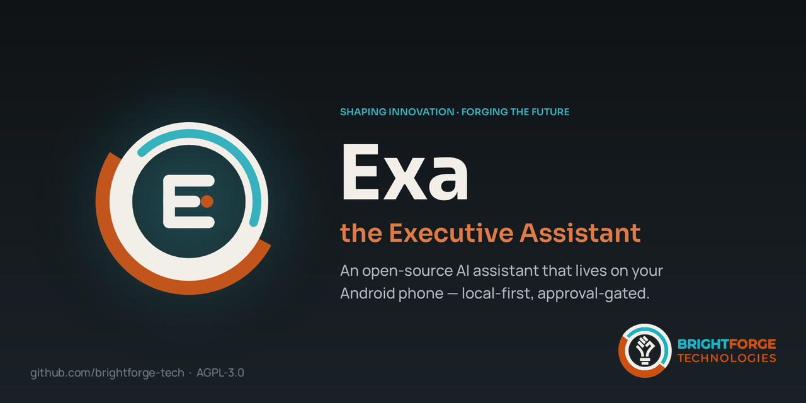

<div align="center">



**An AI executive assistant that lives on your Android phone, not in someone else's cloud.**

Exa reads your messages, email and calendar, keeps your tasks and reminders,
briefs you every morning, and acts for you — always with your approval, and
with every action logged.

[](LICENSE)
[](#quick-start)
[](https://flutter.dev)
[](#roadmap)
[](https://github.com/brightforge-tech/exa/actions/workflows/ci.yml)

[Features](#what-exa-does) · [Quick start](#quick-start) · [Privacy](#privacy-and-safety) · [For businesses](#for-businesses) · [Contributing](CONTRIBUTING.md)

</div>

---

## Why Exa?

Most AI assistants live on a server and talk to your phone through a chat bot.
Exa is the other way around: **the assistant is the phone app.** Your data
stays in an on-device database, and Exa works with what is already on the
phone — WhatsApp, SMS, Signal, Telegram, email, your calendar, your files.

- **Your choice of AI.** Use Claude or DeepSeek with your own key, a model on
  your own PC or server (Ollama, LM Studio, any OpenAI-compatible endpoint),
  or a small model running entirely on the phone. Exa is tuned to stay useful
  on slow local models.
- **It does the work, you approve it.** Sending an email, replying to a
  message or deleting something always asks first. Every tool call goes into
  an audit log you can read.
- **It learns how you work — reversibly.** Exa writes its own working rules
  ("always CC my assistant on supplier emails"), but every rule is versioned,
  reviewable and can be rolled back with one tap. Riskier rules wait for your
  approval.
- **It works while you sleep.** Scheduled jobs prepare your daily briefing,
  sync email, digest chats and follow up on overdue tasks — with a home-screen
  widget to show the result.

## What Exa does

| Area | What you get |
|---|---|
| **Chat** | Type or speak to Exa. It plans, uses tools, and chains several steps per request. Attach photos, PDFs, Word and Excel files. |
| **Messages** | Reads incoming WhatsApp, WhatsApp Business, Signal, Telegram and SMS notifications; summarises chats, transcribes voice notes, and drafts or sends replies with your OK. |
| **Email** | Any IMAP/SMTP account, or Gmail through Google Sign-In. Digests the inbox into tasks and deadlines. Every send needs approval. |
| **Calendar & schedule** | Imports and writes device calendar events; local schedule with a day view. |
| **Tasks & reminders** | One-off and recurring tasks, reminders that survive reboots, snooze/done from the notification. |
| **Daily briefing** | An AI-written morning review of your day, inbox and chats — on a schedule, as a notification and a home-screen widget. |
| **Screens on demand** | Ask for "a board of everything overdue" and Exa builds it from safe, whitelisted components: cards, tables, charts, kanban, forms. |
| **Floating bubble** | Talk to Exa from any app; share the screen with it when you choose to. |
| **Secure browser** | A built-in browser with a "Send to Exa" button — pages reach Exa only when you share them. |
| **Device control** *(optional)* | Set Exa up as the phone's device owner to let it change settings and drive apps through Android's accessibility service. See [docs/PROVISION_DEVICE.md](exa_mobile/docs/PROVISION_DEVICE.md). |

## Quick start

### Install a build

1. Download the latest APK from [Releases](../../releases) and install it
   (allow "Install unknown apps" for your browser or file manager).
2. Open **Settings → AI provider** and choose one:
   - **Claude** or **DeepSeek** — paste your API key.
   - **Local model** — point Exa at your Ollama / LM Studio server, e.g.
     `http://192.168.1.20:11434`.
   - **On-device** — download a small model (Gemma 3 1B, Gemma 3n E2B,
     Qwen2.5 1.5B) and run fully offline.
3. Ask Exa something: *"Remind me tomorrow at 8 AM to call the supplier."*

Tasks, reminders and your schedule work offline even without a model.

> Exa can ask for powerful permissions (notifications, SMS, accessibility,
> device admin). Each one is optional and is switched on only when you enable
> the feature that needs it — in **Settings → Chat apps**, **Phone access** or
> **Device control**. **Settings → Agent permissions** controls what Exa may
> do with them. Because of these permissions Exa is distributed
> as an APK rather than through the Play Store.

### Build from source

Requirements: Flutter (Dart SDK 3.12+), Android SDK, JDK 17+.

```bash
git clone https://github.com/brightforge-tech/exa.git
cd exa/exa_mobile
flutter pub get
flutter test
flutter build apk --debug   # build/app/outputs/flutter-apk/app-debug.apk
```

Developer docs: [exa_mobile/README.md](exa_mobile/README.md) and the full
[architecture guide](exa_mobile/docs/ARCHITECTURE.md).

## Privacy and safety

- **Local-first.** Your tasks, messages, memories and settings live in an
  SQLite database on the phone. API keys and passwords are kept in Android
  Keystore-backed secure storage. There is no Exa server.
- **You choose what leaves the phone.** Text goes only to the AI provider you
  configure. Choose a local or on-device model and nothing leaves your
  network.
- **Approval gates.** Destructive or outward-facing actions (send, reply,
  delete, create a scheduled job) require confirmation in chat.
- **Audit everything.** Every tool call, permission change, export and shared
  page is logged and visible in Settings.
- **Your data is yours.** Export everything as JSON or clear it all from the
  privacy dashboard.

Found a security problem? Please read [SECURITY.md](SECURITY.md) and report
it privately.

## For businesses

Exa is free and open source. BrightForge Technologies also offers:

- **Executive phone setup** — managed Android devices for your leadership
  team, provisioned with Exa, your policies and an on-premises or private
  AI model so company data never leaves your control.
- **Custom skills and integrations** — workflows built around your business:
  CRM, ERP, ticketing, Microsoft 365, WhatsApp Business.
- **Commercial licence** — for organisations that want to ship Exa inside a
  product without the AGPL's source-sharing terms.
- **Support plans** — priority fixes, upgrades and help.
- **Coming soon: Exa Pro** — hosted AI so you don't need your own API key,
  plus sync and backup across devices.

Contact: [info@brightforgett.com](mailto:info@brightforgett.com) · [brightforgett.com](https://brightforgett.com)

## Roadmap

- Exa Pro hosted model relay and encrypted multi-device sync
- Microsoft 365 / Outlook (Graph) integration
- Verified Gmail API access
- Wake word and hands-free mode
- Desktop companion

Have an idea? Open a [discussion](../../discussions).

## The logo


Exa's mark is built on the BrightForge forge ring — the same black ring,
teal arc and orange band as the BrightForge Technologies logo. Inside, the
**E** stands for Exa and *executive*; its three bars echo the base of the
BrightForge bulb and double as a task list. The orange dot is the **spark**:
the AI at work. In the app the teal arc travels round the ring while Exa is
thinking.

<br clear="left">

## Contributing

Contributions are welcome — bug reports, translations, docs and code. Please
read [CONTRIBUTING.md](CONTRIBUTING.md). Code contributions need a one-time
sign-off of our [Contributor Licence Agreement](CLA.md).

## Licence

Exa is licensed under the **GNU Affero General Public License v3.0** — see
[LICENSE](LICENSE). In short: you can use, study, change and share Exa freely;
if you distribute a modified version or offer it to others over a network, you
must share your source code under the same licence. For other terms, see
[For businesses](#for-businesses).

"Exa the Executive Assistant" and "BrightForge" are names of BrightForge
Technologies Limited. Exa the Executive Assistant is not affiliated with
Exa Labs (exa.ai). Third-party notices are in [NOTICE](NOTICE).

---

<div align="center">

<a href="https://brightforgett.com">
  <picture>
    <source media="(prefers-color-scheme: dark)" srcset=".github/assets/brightforge-logo-dark.png">
    
  </picture>
</a>

**Shaping Innovation, Forging the Future**

[brightforgett.com](https://brightforgett.com) · [info@brightforgett.com](mailto:info@brightforgett.com) · Trinidad and Tobago

</div>
