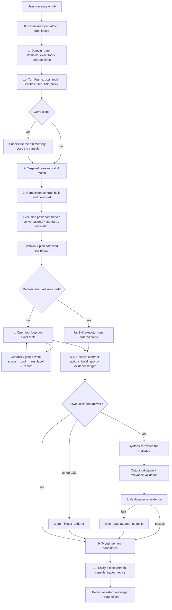

# Exa — Architecture

Exa is a local-first personal assistant for Android. It manages tasks,
reminders, schedule, email, chat messages and files; it can build screens for
itself; and it learns rules about how the user wants things done.

This document describes how it is put together and, just as importantly, why
several things are built the way they are. The "why" sections are the ones
worth reading before changing anything — most of them exist because the
obvious design failed in a specific way.

**Scale:** ~211 Dart files in `lib/`, 53 test files, 760 tests. SQLite schema
v22. 59 agent tools across 11 domains. 4 workflow skills. 4 AI providers.

---

## 1. Design commitments

These are load-bearing. Code that violates one of them is a bug even if it
passes its tests.

| Commitment | Consequence |
|---|---|
| **Local-first** | SQLite is the source of truth. Every agent action writes to a table. The app is fully usable with no network — tasks, reminders and schedule work offline from their tabs. |
| **The model is never the record** | What happened is derived from tool-execution records, never from what the model said it did. Verification compares the two. |
| **Provider-agnostic** | The same pipeline runs against Anthropic, DeepSeek, a self-hosted OpenAI-compatible endpoint, or an on-device model. Capability differences (vision, context size, PDF blocks) are declared by the client, not assumed by callers. |
| **Small models are a first-class target** | Anything that grows — prompts, tool definitions, history, tool results — is budgeted against the *provider's actual context*, not a fixed constant. |
| **Background work is unattended, and treated as such** | A scheduled run cannot send, delete, or rewrite the agent's own rules. Enforced in the executor, not in a prompt. |
| **Failures must be visible** | Background code catches broadly so a job never crashes the app, so every swallowed error records a typed diagnostic instead of vanishing. |
| **Retrieved content is data, never instruction** | Email bodies, web pages and files carry a trust label all the way through. Only the app and the user may direct Exa; a sentence inside a document cannot. Enforced in the capability gate, not in a prompt. |
| **Every record says where it came from** | A memory names its provenance; a task names the job, run and source item that created it. Anything that cannot name its source is outranked by anything that can. |

---

## 2. Map

```
lib/
├── main.dart              app entry: DB open, notifications, jobs, alarms
├── overlay_main.dart      separate entry for the floating overlay
├── app.dart               root widget, router, theme
├── core/router.dart       go_router route table
│
├── agent/                 (70 files) everything the assistant does
│   ├── orchestrator/      turn pipeline, router, turn frame, execution paths
│   ├── tools/             tool registry (52 tools), domains, tool contract
│   ├── security/          capability policy + gate, write scope, content trust
│   ├── behaviors/         behaviour resolution, plans, triggers, budgets
│   ├── skills/            workflow skills (deterministic + guided)
│   ├── memory/            typed memory: lifecycle, retrieval, capsules, context
│   ├── entities/          entity graph + extraction
│   ├── services/          contracts, verification, synthesis, repair, budgets,
│   │                      relevance, deterministic renderers, calibration
│   ├── evaluation/        replay traces and scenario scoring
│   ├── prompts/           system prompt construction
│   ├── config/            response output profiles
│   └── models/            turn contract, execution report, records, results
│
├── data/                  (36 files) storage
│   ├── database/          schema + migrations (v20), write coordinator
│   ├── models/            row models with toRow/fromRow/toAgentJson
│   ├── repositories/      all SQL lives here
│   └── secure_storage.dart  one shared secure-storage configuration
│
├── services/              (29 files) the outside world
│   ├── ai_client/         Claude, DeepSeek, local endpoint, on-device, the
│   │                      shared OpenAI-compatible base + normalizer
│   ├── background_jobs/   job runner, ledger, WorkManager, exact alarms
│   ├── mail/              IMAP/SMTP + Gmail OAuth (XOAUTH2)
│   ├── messaging/         chat capture: notification spool reader, chat
│   │                      export importer, shared-item routing
│   ├── calendar/          device calendar import + mirroring
│   ├── notifications/     scheduling, channels, quiet-hours policy
│   ├── browser/           in-app browser bridge
│   ├── files/             attachment storage and extraction
│   └── overlay/           the floating overlay's own agent stack
│
├── features/              (45 files) screens, one directory per area
└── shared/                providers (Riverpod), theme, shared widgets
```

**Dependency direction:** `features → shared → services → data`, with
`agent` sitting alongside `services` and depending on `data`. Repositories
never import features. The tool registry is the only place the agent touches
repositories and services directly.

---

## 3. The agent turn

`AgentOrchestrator.run()` is the heart of the system. One user message (or
one scheduled job) becomes one turn, in ten stages.



### Routing once, and without deliberation

Routing is a small fixed-shape answer, and two things were wrong with how it
was being asked for. A reasoning model deliberated first, and the
deliberation alone overran the call's 1,024 tokens: two days of server logs
show it cut off in 292 of 295 runs, 31% of all model time, producing
nothing - every one of those turns then ran unrouted. And a scheduled job,
which sends the same instructions every run, was routed every run.

- `OpenAiCompatibleClient.createMessage(deliberate: false)` sends
  `chat_template_kwargs: {"enable_thinking": false}` on backends that
  declare `canSkipDeliberation` (the local endpoint). Measured on the
  device: 227 tokens in 10 seconds, against 1,024 in 48 and no answer. A
  server that rejects the field (400/422) is asked again without it and not
  asked that way again.
- `RouteCache` stores the router's reply for an **isolated scheduled run**,
  keyed by the request, the tool names and the skill names, in the settings
  table under `route_cache.`. The second run of a job makes no routing call.
  Chat turns are never cached: their route depends on the conversation.
- A route that will not compute is tried twice, with room to think, and then
  left alone for 24 hours (`given_up`); the turn runs unrouted meanwhile.

### An answer already written is not written again

`DraftDelivery` lets the action phase's own closing text go to the user
when the turn only looked things up, did all of it, and the text can be
vouched for in code: no failed or changing tool call, every required action
resolved, no tool name in the text, every stated date present in what the
turn read, and the behaviour validators satisfied. Otherwise the turn is
synthesized and verified as before, and the reason is recorded as
`draft_rewritten_because`.

The second call existed for turns whose account of themselves cannot be
taken on trust. A read-and-report turn is not one of those, and rewriting
its answer from a trimmed copy of the same results cost more than writing
it had: 123 seconds for the draft of a morning summary, 153 for the rewrite.

### What a repair is for, and what it is not

The repair call corrects a message that is wrong: a date the turn never
produced, a claim with nothing behind it, a failure left out, a required
part missing. Measured on the device's model over five kinds of fault, it
does that - ten corrected messages out of ten. Four things around it were
wrong, and each one made a working step look like a failing one.

- **It was sent messages with nothing wrong in them.** A digest is routed
  with every create its instructions name marked required, and most batches
  need one or two of them. The create left over stood as work not done, the
  turn failed its check, and a repair - 95 seconds, half the run - rewrote a
  correct message word for word. `SourceGrounding.settleUnneededCreates`
  settles such an action as `skipped` with the reason "nothing in what was
  read called for it", for an isolated run routed to messages or email that
  did read something, and never when a create was tried and did not
  succeed. The writer is shown it as "not needed", not "skipped".
- **It was not told what was wrong.** A turn with planned work genuinely
  left undone sent the repair the message and the report and nothing else.
  The prompt now names each step that was not carried out, and a response
  that says so (`includes_failure_report`) no longer raises
  `unresolved_action` - the action is as undone after the correction as
  before, so without that no repair could ever pass.
- **It was scored on a list it does not return.** A repair must say again
  which required parts the message covers, and the model returns that list
  empty or partial every time. `coveringAlso` credits the corrected message
  with what the first one covered.
- **It was trusted whatever it returned.** A correction now replaces the
  message only if it checks out at least as well (`VerificationResult.score`);
  otherwise the first message is kept and `REPAIR_DISCARDED` is recorded.

It runs without the model's deliberation (`ResponseRepairer.deliberates`),
is no longer than the message it corrects could be (`maxRepairTokens`), and
is told to promise nothing: `ResponseVoice` forbids "I'll make sure it's
there next time", which two of the measured repairs had written. Why a
repair ran is recorded as `repair_reasons` and shown on Tool activity.

**A fifth, found once the first four were out of the way.** On the device
the morning after (2026-09-28), seven digests of eighteen still went for
repair, every one for `unsupported_claim`, three of them on runs that had
created nothing. The prompt offered `emails_digested` as the claim for
"handled" and nothing for a chat, so the model filed "1 chat message read
and marked as handled" under it; the verifier looked for
`mark_email_digested`, which a chat digest has no reason to run, and sent a
true message to be corrected. Measured on the PC against the same model it
was 6 summaries of 12, all of them that claim. `messages_digested` is now
offered, either name is backed by either mark tool, and the writer is told
that something not done is not a claim. The record had said only that a
claim was rejected; `rejected_claims` now keeps which, as written, taken
before the repair - the count `unsupported_claims` is taken after it and
is nearly always zero.

### Why it is shaped like this

**The frame comes before retrieval.** Routing, then retrieval, then the
contract meant memory was fetched before Exa had defined what counted as
relevant — so the block filled with whatever scored highest against the raw
request string. `TurnFrame` (§3.1) states the goal, topic, entities, time
scope, risk and evidence policy first, from the router's existing reply plus
deterministic analysis. No extra model call. The contract still refines it
afterwards.

**Routing picks exact tools, not just domains.** All 52 definitions are
~6,700 tokens, re-sent on every loop iteration; domain scoping cuts that to
~2,500, which is still a lot on a 4k on-device model. The router now reads a
compact capability catalogue (one line per tool, ~450 tokens) and names the
tools it needs; only those get their real schema. Naming none falls back to
domain scoping, so the worst case is the previous behaviour rather than a
turn with no tools. `expand_tools` still widens mid-turn — and a call to it
drops the turn back to domain scoping, because the model has just said the
exact list was wrong.

**The router is shown worked examples, and the user's own names.** This one
call is where the request is actually interpreted, and it was zero-shot: the
JSON schema was described but never demonstrated. Workflow skills carry
`triggerExamples` and the matcher uses them; the stage doing the harder job had
nothing. Four examples now cover the observed failures — two asks collapsed
into one action, a pronoun follow-up not resolved against the entity context,
"show me" answered by listing in chat, and a digest routed without the outputs
it owes. They are **window-gated** (`exampleCountFor`): all four above ~16k,
two above ~8k, none below, because on a 4k model the capability catalogue is
what keeps the *action* call affordable and it wins.

`RequestLexicon` adds the other missing half: the router sees the raw text and
last turn's entities, so "add it to the Q3 doc" is uninterpretable — it has no
way to know that names a thing. The lexicon carries **names only, never the
claim a memory makes**, on a hard ~150-token budget. That distinction is what
keeps it from being retrieval running before the frame: a name cannot pad the
memory block, cannot become an unsourced statement in the answer, and cannot be
wrong in a way that survives the turn. Episodic and temporary memories
contribute nothing — a name that stops mattering tomorrow is noise in a prompt
re-sent every turn.

**The contract exists so completion is checkable.** It records what the user
asked for — actions and required user-facing outputs — before any work
happens. Stage 5–6 resolves it against tool records, so "did this turn
finish" is answered from evidence rather than from the model's closing
paragraph.

**Resolution is per-action evidence, not the turn's mood.** Each action first
gets an *expectation*: the tools whose success would satisfy it, from the
router's `expected_tools` or else derived from the registry's tool names. If
the expectation is known and nothing in it ran, the action stays `pending`
however well the rest of the turn went — see §6.2.

**Not every turn needs the whole pipeline.** A deterministic complexity and
risk classifier (§3.2) picks one of four paths. Escalation needs **two**
independent signals: most consequential requests trip one on their own, and
a reviewer on every turn costs more stability than it buys.

**Routine answers are written in code.** A confirmation does not need a
model, and a model asked to confirm a stored date is the one component that
can get that date wrong. `DeterministicRenderer` handles task/reminder/event
creation, job creation, sync results and permission denials, copying the
`..._label` verbatim. It declines whenever anything failed, the outputs need
judgement, or the turn escalated.

**Synthesis is separate from action.** The tool loop's own closing text often
carries useful analysis, but it is written mid-work. A final no-tool call
turns the contract, the execution report and the evidence pack into the
user-facing answer. Because no tool definitions are sent, that call
physically cannot act again.

**The answer is written for the reader, not the developer.** The synthesis
and repair calls get their material in system vocabulary — required outputs
as wire names, contract actions that are literally tool names, the report as
JSON — and a model left to itself writes that vocabulary straight back:
"Confirmation: sync_messages completed, and two read_message_context
operations are recorded… Task list: none." Three things stop that.
`ResponseVoice.rules` (`agent/prompts/response_voice.dart`) is one block of
plain-language rules appended to *both* prompts: write to the person, never
tool names or "execution report", outputs are a checklist not headings, an
empty item is one sentence, a failure is stated as what it means for the
reader. `ResponseOutputType.readerNeed` gives each wire name its meaning
("rundown: a short rundown of what came in and what matters") so the prompt
can say "cover this in prose" and mean it. And `ToolLabels`
(`agent/services/tool_labels.dart`) is the one table of human wording per
tool — "check for new chat messages" / "Checked chats" — used by the prompts'
action list, the report builder's action summaries, the `Done (…)` and
permission-denied fallbacks, and the pills under a chat bubble. The
synthesizer also detects a *quiet* turn in code (only sync/read/mark tools
ran, nothing created, nothing failed or left undone) and tells the model to
answer in a few sentences, because a small model reads "cover every output"
as "write every output". Raw tool names remain on the Tool activity screen,
which is where debugging happens.

**A guided skill's recipe tools are always callable.** Exact-tool loading
sends only the tools the router named, and the router names them before the
skill is known. The scheduled daily review used to run as `digest_emails`,
whose recipe ends at "mark digested"; its prompt also asked for today's
schedule, open tasks and reminders, but `list_schedule` / `list_tasks` /
`list_reminders` were never in the exact list, so the model was told to
review a day it could not look at — and said so, in report-speak. Two fixes:
a dedicated guided `daily_review` skill (triggered by "daily review", which
the job's fixed prompt uses, and which contains no `digest_emails` or
`prepare_daily_briefing` trigger phrase) whose recipe goes on to the day; and
the orchestrator widening a non-empty exact list with a matched guided
skill's step tools. Domain scoping already covered the skill's domains.

**A quiet job run posts nothing.** `QuietTurn` (`agent/services/quiet_turn.dart`)
decides in code, from the records, whether a turn found anything to say: only
housekeeping tools ran (`sync_*`, `read_*_context`, `mark_*_digested`), every
sync/read reported zero new items (`sync_emails` now returns `new_emails` for
this), nothing was created or changed, nothing failed, no required action was
left undone. Doubt — a result without a count, a tool outside the set — is not
quiet. `run(suppressQuietChatMessage: true)` keeps such a turn out of chat
history; `AgentTurnResult.wasQuiet` tells the job runner to skip the
notification too, and to log `JOB_QUIET_RUN`. The run and its summary still
land in the job history. A chat turn is never suppressed.

**Two different validators run on the answer.** Verification asks *is this
true?* — claims against evidence. `RelevanceValidator` asks *was this asked
for?* Every section must map to a required output, an executed action, a
warning, or a next step. That is the failure that produces technically
correct but irrelevant padding. It is deliberately lenient: a section is
flagged only when it shares nothing with the turn's vocabulary, and a repair
is requested only when most of the message drifted.

**Repair happens at most once, and cannot act.** Verification, output-rule
and relevance failures are corrected by one further no-tool call. There is
deliberately no repair loop.

**Everything Exa says leaves through one door.** `ResponseGateway` (§7.1) is
the last thing between any user-visible string and the user — the synthesized
answer, the fast path, the fallback confirmation, every provider error, the
background briefings and the notification bodies. Output discipline used to
apply to the synthesized message alone, which meant the *commonest* kind of
turn was the one it never reached.

---

## 3.1 The turn frame

`agent/orchestrator/turn_frame.dart`. Built immediately after routing, from
the router's reply plus deterministic analysis of the request.

| Field | Where it comes from | What it changes |
|---|---|---|
| `primaryGoal` | Router, or the request's first sentence | Prompt framing, relevance vocabulary |
| `entities` | Active entity context | Retrieval scoring, ambiguity detection |
| `timeScope` | Deterministic phrase parsing (`today`, `next week`) | Filters time-bound memories only |
| `activeTopicId` / `topicShifted` | Content-token hash vs the previous turn's | Which capsule replays, memory topic match |
| `risk` | Deterministic; the router may **raise** it, never lower it | Escalation, evidence policy |
| `evidencePolicy` | Risk + required outputs | Whether unsupported statements are allowed |
| `assumptionPolicy` | Risk + unresolved slots | Assume silently / disclose / ask |
| `unresolved` | Bare reference, missing time, contradictory scopes (§3.3) | A blocking slot makes the turn read-only and owe a question |
| `responseTokenBudget` | Required outputs + risk | Output reservation and the length instruction |

**Risk is asymmetric on purpose.** A model that under-reports difficulty
would otherwise be choosing its own supervision.

**Time scope fails open.** An unparsed phrase leaves the scope null. An
unfiltered retrieval is noisier; a wrongly filtered one silently drops the
answer. Weekday names resolve through the same mapping
[`upcomingWeekdayMap`] gives the action prompt — the frame and the prompt
must not disagree about what "Friday" is, or "what's on Friday?" gets no
filter while the reminder it creates gets the right date.

---

---

## 3.2 Execution paths

`agent/orchestrator/execution_path.dart`.

| Path | When | What runs |
|---|---|---|
| `deterministicCommand` | A confidently matched deterministic skill | Ordered steps, no open loop |
| `conversational` | Router explicitly returned no domains and no actions, low risk | One no-tool call |
| `standard` | Everything else | The full pipeline |
| `escalated` | **Two or more** signals below | Verification forced on, no deterministic shortcut |

Signals: destructive/financial action, blocking ambiguity, conflicting
memories, more than three dependent steps, low routing confidence, retrieval
that returned only unreliable memories, a previous repair failure,
instructions derived from external content.

**"Retrieval found nothing" is not a signal.** Returning zero memories is a
valid and common outcome — a fresh install has none — and treating it as
risk would escalate every consequential request forever. What counts is
retrieval that found things and none of them can be relied on.


---

## 3.3 When Exa cannot tell what was meant

`agent/orchestrator/turn_frame.dart` finds the ambiguity;
`CapabilityPolicy.readOnly` is what makes it matter.

For a while this was detected and then ignored. `_assumptionPolicyFor`
returned `AssumptionPolicy.askFirst`, **nothing read that value**, and the only
visible effect was a prompt line suggesting the model ask plus one escalation
signal — and escalation needs two. So the turn went ahead on a guess, and this
document claimed execution stopped.

A blocking slot now turns the turn into a question, in code:

- **Reads stay available, writes do not.** `CapabilityPolicy.readOnly` allows
  only `ToolCapability.read`, so the gate refuses every write whatever the
  model asks for. Reads are kept deliberately: it is the difference between
  "Two tasks could be *it* — Send invoice to Acme, or Chase the Acme invoice?"
  and a bare "which one?".
- **It is narrower than `unattended`,** which still permits `localWrite`. The
  restriction here is not "nobody can approve this", it is "we do not yet know
  what to do", and a task created on the wrong reading is exactly the surprise
  this prevents.
- **The refusal says why.** A distinct `awaiting_clarification` code, because
  the unattended wording ("blocked in a scheduled run") is false on an
  interactive turn and sends the model looking for the wrong recovery.
- **The question is a required output.** `followUpQuestion` joins the
  contract, so `TurnVerifier` fails the turn if it does not actually ask — no
  new checking code was needed.
- **Planned actions are marked `skipped`, not left pending.** Skipped is
  terminal, so the resolver (§6.2) leaves them alone and
  `unresolvedRequiredActions` stays 0. **A turn that asked is not a turn that
  failed**, and the completion metric must not conflate them.
- **Deterministic rendering is excluded explicitly.** The `containsAll` check
  would decline today, since no renderer produces `followUpQuestion` — but
  `analyze_snippet` already declares that output, so a renderer case added for
  it would silently start answering these turns without asking anything.

The honest answer does two things: the blocked write is recorded as a refused
action, so the message must say nothing was done **and** ask. Declaring only
the question leaves `undisclosed_failure` unsatisfied, correctly — "which one?"
alone reads as though the work is still pending.

**An unattended run never asks.** This one cost an outage on the device before
it was caught. A scheduled run has nobody to answer, so a turn that stops to ask
does nothing and reports nothing done — and the user's every-30-minutes email
digest says *"Sync new emails and Digest **them**"*. The pronoun tripped the
bare-reference rule, "email" made the turn high risk, and the whole job went
read-only: `sync_emails` refused with `awaiting_clarification`, run after run,
reporting "No emails were digested this time". `_assumptionPolicyFor` now never
returns `askFirst` when unattended, and the orchestrator gate carries
`&& !isUnattended`. The slot still contributes its escalation signal, so the
turn is still verified more closely; only the stop-and-ask is withdrawn, and
`assumeAndDisclose` makes it say which reading it took — which is what the
unattended banner already asked of it.

**Generalize it:** anything that can halt a turn pending user input must be
gated on `isUnattended`. There is no exit from "waiting for the user" in a
background isolate.

**A pronoun with its own antecedent is not a dangling reference.** Three content
words before the pronoun is the line: "delete it" and "now cancel it" fall under
it and genuinely reach back to a previous turn, while "sync new emails and
digest them" clears it and needs no previous turn to be read.

### What counts as blocking

Detection is deliberately narrow, and blocking stays gated on risk except
where noted. An assistant that asks about everything is worse than one that
occasionally guesses and says so — `clarificationRate` has a regression
ceiling for exactly that reason.

| Slot | Fires when | Blocking |
|---|---|---|
| `referent` | Bare reference, nothing at all in scope | High risk |
| `referent` | Bare reference, several same-type candidates | High risk |
| `time` | A reminder/event intent with no time stated | **Always** |
| `time_scope` | Two different scope phrases in one request | Never |

**A missing time is always blocking** because, unlike a referent, there is no
most-likely reading to fall back on — every choice is invented, and a reminder
on the wrong day is worse than no reminder, since the user stops watching for
the thing themselves.

**The zero-candidate case tests two sources, and both are load-bearing.** The
check used to require *more than one* candidate, so "delete it" with nothing in
scope produced no slot at all — the least resolvable case sailed through. But
testing `frame.entities` alone is also wrong: the entity graph is empty on a
fresh install and whenever the intelligence layer is absent, which would turn
"remind me to stretch" → "now cancel it" into a question. So the previous
turn's own record of what it touched (`priorTurnEntityIds`, from the assistant
message meta the router already reads) counts as a referent too.

`hasExplicitTime` is a separate question from `parseTimeScope`: the latter
answers "what window should retrieval filter to" and returns nothing for "at
3pm". Both live in the same class so their patterns cannot drift apart.
---

## 4. Tools

`ToolRegistry` owns every capability the agent has. A tool declares a name,
description, JSON input schema, a permission group, and whether it needs
confirmation.

**Every execution path goes through `ToolRegistry.execute`** — the open loop
and the deterministic skill executor both. That makes it the one place where
gating can be enforced, in this order:

1. **Capability gate** (run mode + job permissions) → `ToolResult.denied`
2. **User permission** group toggle (Settings → Agent permissions)
3. **Schema validation**
4. **Idempotency check** — a successful call with the same key returns the
   stored result rather than acting twice
5. Execute, log, record

Domains: `core`, `tasks`, `reminders`, `calendar`, `email`, `messages`,
`files`, `browser`, `background_jobs`, `dynamic_ui`, `behavior_rules`,
`phone`.

### Generated content has one home: the files table

The agent cannot invent storage. When it produces something the user wants
to keep — a digest, a summary, extracted notes — it calls `write_file`,
which puts the text in `attachments` (`source` carries the caller's
category). `store_file` is the different case: bytes the *user* attached
this turn.

**A rejected schema is how the agent learns the schema.** Observed on device:
the model's first `create_dynamic_screen` used a filter operator that does not
exist, got an error naming the allowed operators, and fixed it on the very next
call. The same schema's `{{due_at_label}}` placeholder was *not* validated,
shipped, and rendered every card with a dangling "Due" and nothing after it.
Validation errors are the feedback channel — anything left unchecked is
something the agent will keep getting wrong. So templates are validated too,
and `{{column_label}}` is supported rather than rejected: the agent already
meets that convention on every tool result, and `{{due_at}}` alone would put a
raw `2026-07-24T10:00:00.000` on a card.

That matters because `create_dynamic_screen` queries a fixed whitelist
(`ScreenSchema.allowedTables`) and rejects anything else, by design — the
schema becomes a raw SQLite query, so a free-form table name would be an
injection surface. `attachments` is on the whitelist, so
`write_file` → `create_dynamic_screen` on `attachments` filtered by
`source` is the supported path from "Exa wrote something" to "the user has
a screen of it". Note the display column is `name`, not `title`, and
`file_path` is deliberately not queryable.

**A screen can read several tables at once.** `data_sources` is a map of
named queries and each data-bound component says which one it reads with
`source`; the original singular `data_source` is read as the one source named
`default`, so every screen built before this keeps rendering and the renderer
has a single shape to handle. Each component is validated against the columns
of *its* source, which is what catches a template naming a column of some
other source on the same screen. Two sources and no binding is a rejection
rather than a guess — guessing is how a screen quietly shows the wrong table.

**Stats are counted in SQL, not over the fetched rows.** A `stat` component
(`count`/`sum`/`avg`) runs its own aggregate against the source's WHERE
clause. Counting the rows the list already has would silently report the row
limit — "200 open tasks" forever.

**Rows can act, through the same door forms use.** A `list` may carry
`on_tap` (navigation only) and up to
`ScreenSchema.maxRowActions` buttons, each naming a tool from
`ScreenSchema.allowedRowTools` with params templated from the row
(`{"id": "{{id}}"}`). Those run through `ToolRegistry.execute` — validated,
gated and logged like everything else. The allowlist is the guarantee, and it
is narrow on purpose: a row button has no confirmation dialog to show and no
agent loop around it, so nothing destructive or outbound may be on it. A test
pins both properties against the real registry, so classifying a tool wrongly
later fails the suite rather than shipping a delete button into a screen the
model wrote.

**A screen can be thrown away.** The bookmark only decides whether a screen
sits in the nav menu, so screens used to accumulate invisibly with no way
out. Deleting is now a distinct choice - in the screen's own menu, in the
long-press on its menu tile (hide vs delete), and as `delete_dynamic_screen`,
which is classed destructive and so is refused to unattended runs and asks
the user first. Deleting a screen removes a saved question, never the data it
was asking about.

---

## 4.1 Chat messages (WhatsApp and friends)

`services/messaging/`, plus `android/.../kotlin/com/brightforge/exa/messaging/`.

**There is no personal WhatsApp API.** The Business Cloud API only receives
messages addressed to a registered business number and cannot be attached to a
number already on the consumer app; the on-device message store is encrypted
with a key that needs root. So "connect WhatsApp like email" does not exist,
and three OS-level paths do:

| Path | Gives | History | Reply |
|---|---|---|---|
| `NotificationListenerService` | messages as they arrive, per-sender via `MessagingStyle` | no | yes, borrowed |
| Chat export (`.txt` / `.zip`) | one chat, verbatim | **yes** | no |
| Share / `ACTION_PROCESS_TEXT` | one message the user pointed at | n/a | no |

All three land in one `inbound_messages` table with a `channel` column, and
the read/digest/reply tools are written once. **The same listener API serves
Signal, Telegram and SMS unchanged**, so a per-app table would have meant
re-implementing digest, dedupe and triggers four times for no new behaviour.
`email_items` deliberately stays separate: mail has a subject, a thread and an
account, and folding two shapes into one row puts a nullable column on every
read.

### The handover is a file, not a platform channel

`MessageSpool.kt` appends one JSON object per line to `filesDir`;
`MessageSpoolReader` renames-then-reads it.

The listener is started by the system whenever it likes, routinely with the
process otherwise dead and no Flutter engine in existence — so there is often
nothing on the other end of a channel to call. Worse, the code that *drains*
it runs in the WorkManager isolate, whose engine never sees the MethodChannels
`MainActivity` registers: a channel would have worked in the foreground and
silently done nothing in the background, which is the half of this feature
that matters. A file is reachable from every isolate, survives the process
dying between a message arriving and Exa waking up, and needs no engine.

**The path is asked for over the bridge and cached in `settings`**, not
derived from `getApplicationSupportDirectory()`. Both resolve to `filesDir`
today, but that is path_provider's implementation detail — and if it changed,
the failure mode is capture that appears to work and ingests nothing. The
derived path stays as a last resort.

**Kotlin never writes SQLite.** The Dart side owns the schema and every write
goes through a repository so dedupe and provenance have one home; a second
writer in Kotlin would be a second migration path.

### `external_id` is a content hash, not an app-supplied id

WhatsApp re-posts *one* notification per chat carrying every recent message in
it, so the same message arrives many times under the same notification key —
and the notification carries no message id at all. The hash covers channel,
conversation, sender, timestamp and body, which is also what makes "the same
message" mean the same thing whether it came from a notification, an export or
a share.

**The timestamp is truncated to the second.** `MessagingStyle` entries carry
millisecond precision that differs between the post that first announced a
message and the re-post that carries it beside a newer one. Hashing the raw
value made every re-post look new — the exact duplicate storm the hash exists
to prevent.

Dedupe is enforced by a **partial unique index**, not a select-then-insert:
four things open this database (§9) and all of them can drain the same spool,
so a check in Dart would be a race under exactly the concurrency this app
treats as normal. The index is partial because a manually pasted message has
no hash to compute, and two identical pastes are two deliberate acts.

### The conversation key is the chat's name

Not the notification key or tag, which look more precise and are not: they
change between app updates and carry a jid Exa can show nobody. The chat name
is also the only key an *export* can supply, and live-captured messages have
to land in the same conversation as imported ones or "scan my chat with Alice"
reads half of it. Two chats sharing a name merging is the accepted cost, and
it is visible rather than silent.

### A reply is borrowed, and says so when it cannot be

`ReplyRegistry` holds the `PendingIntent` Android handed over from the chat
app's own notification. It cannot be persisted — a `PendingIntent` is not
serializable, and one recovered from a dismissed notification fails inside the
other app's code rather than ours. So the contract is narrow and honest:
replies work while the message is unread in the shade, and fail with a stated
reason once it is not. Reporting "sent" for a reply that went nowhere is the
one outcome worth engineering against.

That the registry lives in the main process is also why `reply_to_chat` can
only run on an interactive turn — which is where it belongs anyway:
`ToolCapability.outbound` already refuses it to unattended runs, and refuses
it again once external content is in the turn.

**A delivered reply is stored as a message from the user.** Without it, the
next digest reads the same incoming question with no sign it was answered, and
answers it twice.

### Imported history arrives digested; captured messages do not

A year of back-messages is something to ask about, not a queue of work.
Dropping 5,000 imported messages into the backlog would have every background
run for a week working through a conversation that ended months ago.
`referenced` is a third state, independent of `digested`: the user pointing at
one message has to survive a background job digesting it, or "what did Alice
mean by that?" loses its subject.

### Export parsing: what it refuses to guess

Three formats are handled (iOS bracketed, Android dashed, US 12-hour), plus
continuation lines — WhatsApp writes multi-line messages with no stamp after
the first, so dropping those silently truncates exactly the long messages
worth reading.

**Date order is deduced, and the assumption is disclosed when it cannot be.**
A component over 12 can only be a day, which settles the file outright. When
every date is ambiguous, day-first is used *and reported as assumed* —
reading `03/04` as the wrong month files a whole conversation under the wrong
date, and that must not be silent. Same rule for the size cap: over 5,000
messages the newest are kept and the count dropped is stated.

### Reading as little as possible

Notification access is device-wide: the service is offered every OTP, banking
alert and private notification on the phone. So the allowlist check is the
*first statement* in `onNotificationPosted`, before any field is read, and
nothing is kept, logged or spooled for a package the user has not chosen. The
allowlist lives in SharedPreferences because the listener must decide with no
engine alive; `ChatPackages.setAllowedPackages` filters to packages this build
can parse, so a malformed call from Dart cannot widen it.

The Dart catalogue (`MessageChannels`) is a second copy of that list, for
rendering and for naming a channel in a tool result. `chat_capture_test.dart`
reads `ChatPackages.kt` and fails if they disagree — the duplication is
deliberate, them drifting is not.

### What it cannot do, stated in the UI

Settings → Chat apps is as much an explanation as a control panel, because the
limits are genuinely surprising and a digest read as complete when it is not
is the failure that follows: nothing from before the grant, nothing from a
chat open on screen, long messages possibly truncated, media as a placeholder,
replies only while unread. The `read_message_context` description tells the
model the same thing, because the model is the other party that would
otherwise present a partial message as the whole one.

---

## 4.2 Phone access (SMS, calls, WhatsApp, contacts)

`services/phone/`, `packages/exa_phone/` (Kotlin), and the `phone` tool
domain: `find_contact`, `send_sms`, `place_call`, `send_whatsapp`.

**The native half is a local Flutter plugin, not a channel in MainActivity.**
The generated plugin registrant runs for *every* `FlutterEngine` in the
process — the app, the overlay engine, and the WorkManager/alarm isolates
that run scheduled jobs — whereas a channel registered on the activity
exists only in the main engine. "Text Mum every Friday at five" runs in the
background isolate, so the channel has to be a plugin or the job would
silently do nothing (the same lesson as the message spool, from the other
direction). Don't fold `ExaPhonePlugin` back into `MainActivity`.

**The result vocabulary is the honesty contract.** `PhoneActions` reports
`sent` / `placed` (done), `dialer_opened` / `composer_opened` (the user
still has to tap), `notified` (a one-tap notification was posted because
nobody was there), or `failed`. The tools carry those words into their
results and the model is told, in the description, that only `sent: true`
may be reported as sent. WhatsApp is why: a personal account has no send
API, so `send_whatsapp` answers through the chat's own notification reply
action when that chat is live in the shade (the existing `ReplyRegistry`,
lent to the plugin by `ExaApplication`), and otherwise opens WhatsApp with
the message typed in — a composer, not a delivery.

**Recipients are resolved, never guessed** (`PhoneRecipientResolver`): a
typed number passes through; a name must match exactly one contact, an
exact match beating a substring, and a card with several numbers needs a
primary, a Mobile, or the asked-for label — anything else is a refusal that
lists the options, because a message to the wrong person cannot be taken
back. Sent texts and WhatsApp replies are recorded in `inbound_messages` as
"You", so the next digest sees the conversation was answered.

**Scheduled sends.** The three outbound tools are `outbound`, so a scheduled
run cannot reach them — unless the job carries an **outbound grant** (§5).
Even then a scheduled *call* dials only while the phone is on and unlocked;
otherwise it posts a tap-to-call notification, because a phone that starts
ringing someone from inside a bag is not a feature. The tools learn which
run they are in from `ToolRegistry._executing`, read in their first
statement.

---

## 5. Security model

`agent/security/capability_policy.dart`.

Two run modes: **interactive** (a user is present and can confirm) and
**unattended** (a scheduled run). Tools are classified by their worst effect:
`read`, `localWrite`, `destructive`, `outbound`, `selfModifying`, `purchase`.

A turn may also be narrowed **below** its run mode by passing a
`CapabilityPolicy` on the `CapabilityContext` — `readOnly`, used by an
ambiguity-blocked turn (§3.3), and `lockScreen`, used by every turn typed or
spoken on the lock screen (§10): the user is present and can confirm, but
has not unlocked the phone, so reads and local writes run and anything
outbound, destructive or self-modifying waits for an unlock. Each policy
carries its own `CapabilityRefusal`, because the refusal text is what the
model reads and acts on: told "blocked in a scheduled run" on an interactive
turn it goes looking for the wrong recovery, and told that on the lock screen
it would never say "unlock your phone".

An unattended run may only `read` and `localWrite`. It cannot email anyone,
delete anything, spend money, or change the agent's own rules and schedule —
**regardless of what the model asks for**. A prompt saying "nobody can approve
anything" improves behaviour; it is not a boundary.

### Outbound grants: the one way a job is wider than its run mode

"Text Mum every Friday at 17:00" is a real request, and the rule above
would make it impossible. So a job may carry `outbound_grants` in its
`permissions_json`: a list of *outbound* tool names it may use unattended.
The grant is deliberately narrow in every direction — it names one tool at
a time; it is made by `create_scheduled_job`, which asks the user to confirm
and whose description tells the model to grant only what was asked for; the
Jobs screen prints it ("may send a text message without asking"); the gate
honours it only for `outbound` capability and only under the plain
unattended policy (not `readOnly`, not `lockScreen`); and it still yields to
`blocked_tools`, `allowed_tools` and the external-content gate, so a message
the job read cannot talk it into sending one. `WriteScope.forJob` widens the
job's scope by the granted tools' effects (`message.send`) so the ledger
counts the sends instead of refusing them one line after the gate allowed
them. Tests: `outbound_grants_test.dart`, `phone_tools_test.dart`.

### Write scope: `localWrite` was still too broad

`agent/security/write_scope.dart`. Creating a *recurring* task every morning
is technically a local write, and it is also exactly the surprise a user
cannot explain. Effects are finer-grained than capabilities:

```
task.create            task.create_recurring     task.update_status
reminder.create_one_time    reminder.create_recurring
email.create_draft     email.mark_digested       email.sync
message.mark_digested  message.sync              message.send
calendar.create_event  calendar.create_pending_event
behavior.propose       behavior.apply            job.create   job.modify
```

An unattended run gets [`WriteScope.unattendedDefault`]: everything a
background job legitimately does, and **nothing recurring**. A job may
narrow itself further by declaring `allowed_effects` and per-effect
`max_per_run` / `requires_source_item` / `allow_recurring` in its
`permissions_json`.

**A job that declares nothing keeps the default.** The decode returns the
fallback when `allowed_effects` is absent entirely — only an explicit list
narrows. Otherwise adding this feature would have silently stopped every
existing job from writing anything.

### Untrusted content

`agent/security/content_trust.dart`. Exa reads email bodies, web pages,
files and attachments, all of which can contain sentences shaped like
instructions.

Chat messages are the most exposed source in the app and are labelled the
same way: anyone can be added to a group, so a sentence shaped like an
instruction can arrive from someone the user has never met. `read_chat`,
`read_message_context`, `sync_messages` and `list_chats` are all in
`externalContentTools`, which is also what makes rule 2 below bite — once a
captured message is in the turn, an unattended run cannot reply to anyone.

| Trust | May direct actions? |
|---|---|
| `systemInstruction`, `userInstruction`, `userSavedRule` | yes |
| `verifiedAppState`, `generatedSummary` | no |
| `externalContent` | **no — data, always** |

Enforcement, in order of how much it depends on wording:

1. **Structural.** Every tool that returns outside content is listed in
   `ExternalContentGuard.externalContentTools`. Its payload is walked in
   `ToolRegistry.execute`, free-text fields are scanned, and directive-shaped
   lines are *marked in place* — never deleted. An email that genuinely asks
   for something is information the user may want; the point is that Exa
   reports it rather than obeys it.
2. **Capability.** Once external content has entered a turn, an unattended
   run cannot perform an `outbound`, `destructive`, `selfModifying` or
   `purchase` action at all. An email cannot authorize Exa to act on the
   email's behalf.
3. **Prompt.** The rules are restated in the system prompt, but only on turns
   that can actually reach outside content, and only so the model's reasoning
   matches what the gate will do anyway.

**An unlabelled block is treated as external.** Failing safe means assuming
it came from outside.

### Creation provenance

Every record the agent creates records `origin_type`, `origin_job_id`,
`origin_run_id`, `origin_tool_call_id`, `source_record_id`,
`authorization_source` and `origin_reason`. Job history shows what a run
produced and offers to undo exactly that set. Stamped in
`ToolRegistry.execute` via `ProvenanceRepository` rather than threaded
through every model and repository — the one place that knows the security
context writes it, and every repository stays unchanged.

Precedence, highest first — a lower level can never widen a higher one:

```
system safety  →  capability restrictions  →  job permissions
               →  behaviours  →  preferences  →  defaults
```

A job may be narrowed further than its run mode (`allowed_tools` /
`blocked_tools`), so a mail-triage job can create drafts without being able to
send them. Blocks always beat allows. An allow-list governs what the job may
*change*: `read` tools pass it regardless, because a job narrowed to "create
tasks from my chats" still has to look at the tasks and schedule it already
has, or it files duplicates and books clashes - the very thing the list was
meant to prevent. A listed tool also admits other **local writes of the same
kind** (the write effect's family: `create_schedule_event` admits
`update_schedule_event` and `sync_device_calendar`), because a job that may
add an event has to be able to move the one it added when the next message
reschedules it; the widening never crosses into outbound, destructive or
self-modifying tools, which must be named and are still subject to the run
mode. Anything a job must not do is a `blocked_tools` entry. The Jobs screen
describes such a list by kind ("otherwise only works on reminders, the
schedule, tasks, chat messages").

**Unknown tools fail closed** — an unclassified name is treated as `outbound`
and is therefore unavailable to background runs. A registry test asserts every
registered tool is classified, so a new tool must be classified deliberately
rather than discovered missing in production.

---

## 6. Behaviours

Behaviours are the user's saved rules about how Exa should work. They live in
`agent/behaviors/`.

A behaviour has: type (11 kinds), rule text, priority, risk level, and —
critically — **`params`**, machine-readable settings that let a rule be
enforced by code rather than merely read as prompt text.

### Enforcement modes

| Mode | Meaning |
|---|---|
| `advisory` | Prompt text the model should follow |
| `output_validated` | Additionally checked in code after the model answers |
| `code_enforced` | Implemented by the app (quiet hours, event defaults) — **kept out of prompts entirely**, since restating a guarantee wastes tokens |
| `mandatory` | Safety rules: always apply, always render |

### Compilation

`BehaviorPlan.compile()` turns active rules into **four different blocks**,
one per model phase — planner, action, synthesis, repair. The planner needs
tool and decision rules; the writer needs tone and formatting; the repairer
needs only what it broke. Sending one shared block to all three wasted tokens
and diluted each call.

Resolution order:

1. Drop expired rules and **unknown types (fail closed, logged)**
2. Deduplicate near-identical rules — otherwise never-dropped safety rules
   grow without bound
3. Resolve `conflict_group` collisions with a **total order**, so the same
   inputs always resolve the same way: system safety → code-enforced →
   scope specificity → explicit-over-inferred → priority → recency →
   confidence → id
4. Split off code-enforced rules (no prompt cost)
5. Render per phase within a token budget
6. Hand the full resolved set to deterministic consumers

Everything is recorded in a `BehaviorTrace` — what applied, what lost a
conflict and to what — stored on the assistant message so "why did Exa do
that?" is answerable afterwards.

### Triggers

A behaviour can *cause* work, not just shape it:

```json
{"trigger": {"on": "new_mail", "action": "digest",
             "min_interval_minutes": 30, "max_items": 15}}
```

Deterministic jobs consult triggers after they run. This is what makes
"digest my email when it arrives" real — the sync job has no model call, so a
prose-only rule has nothing to attach to and would only ever influence the
wording of a report.

`new_message` is the chat equivalent, raised by `message_sync`. A separate
event rather than a shared "new item": a user who wants mail digested hourly
and group chats left alone has to be able to say so, and one event with a
filter cannot express that. Its firing also applies `TriggerScope` **in code
before the model turn**, because a busy group chat produces far more traffic
than a mailbox and a rule scoped to two people must not spend a turn reading
forty messages from everyone else first. `message.send` is absent from the
firing's write scope: a rule that fires on incoming messages and can also
answer them is an assistant holding conversations nobody asked it to have.

Triggers fire on the **backlog**, not only on new arrivals (or a queue that
built up while the rule was inactive would never drain), pace themselves
against `min_interval_minutes`, and forgive most of that interval when a run
leaves work behind, so a backlog converges over a few runs instead of one
batch per interval.

### Typed consumers

- `NotificationPolicy` — quiet hours. Suppresses **content** (job briefings,
  which are also in chat so nothing is lost) but never **system health**
  ("your review could not run") — a quiet night must not become an invisible
  outage. Timed alerts are deferred only if the rule opts in, and recurring
  reminders are never moved, since shifting one rewrites the whole series.
- `ScheduleDefaults` — default event duration and reminder lead time.
- `OutputValidator` — measurable rules (`max_bullets`, `no_markdown_tables`,
  `require_json`) checked and where possible **fixed in code**, so a repair
  round trip is spent only on what code cannot fix.

---

## 6.1 Memory lifecycle

`agent/memory/`. Retrieval used to score every live memory against the raw
request string and fill an 8% budget with whatever came top. Three things
were missing, and each produced a different visible failure.

### Every memory is typed and sourced

`MemoryKind` says what kind of claim it makes (explicit preference, verified
fact, commitment, episode, project state, inferred preference, temporary
working state, correction). `MemoryProvenance` says how it came to be known.

**Model speculation can never become memory.** The write policy rejects it
outright, before scores are considered. Everything stored traces to a user
statement, a tool result, or a deterministic inference that is labelled as
inferred. A remembered hallucination is repeated back as fact forever.

**Temporary information expires.** Anything temporary gets a `valid_until`
before the policy sees it — "I'm working from home today" is true for a day.
`validUntil` is separate from `expires_at`: a memory can stop *applying* long
before it is deleted.

**Inferred preferences decay.** A first sighting is stored with a 21-day
window and marked `tentative` in the prompt; it needs three independent
observations to become durable. Otherwise one unusual request permanently
distorts future answers.

### Corrections supersede

"No, that meeting is Friday" used to add a *second* memory alongside the
Thursday one, leaving retrieval free to surface either. `MemoryLifecycle`
detects the correction from a narrow set of phrasings, finds the memory it is
most plainly about (word overlap, plus topic and entity match, plus
recency), marks it contradicted, writes an authoritative correction that
points at it, and flags the topic's capsule stale.

**It supersedes nothing when nothing matches well enough.** Superseding the
wrong memory is worse than superseding none.

### Retrieval scores relevance, not similarity

```
retrieval_score =
    semantic + lexical + entity_match + topic_match + recency
  + explicit_priority + source_reliability + importance + type_floor
  - contradiction_penalty - stale_penalty - tentative_penalty
```

The pipeline runs: frame → query decomposition → entity expansion → hybrid
lexical + semantic → validity and time filter → contradiction filter →
diversity dedupe → relevance threshold. Each selection records its component
scores, so "why was this in context?" is answerable from a trace.

**Returning nothing is a valid answer.** The 8% budget is a ceiling, not a
quota. Filling it with the best of a bad set is exactly how an assistant ends
up repeating stale information back at the user.

**Time filtering applies only to time-bound memories.** A standing preference
is timeless and must not be filtered out by "what's on today?".

### Evidence

`EvidenceLedger` wraps retrieved memories and successful tool results in
envelopes carrying an id, source, trust label and confidence, and hands the
synthesizer a bounded pack. Content read from outside the app keeps its
`externalContent` label all the way through, so a claim sourced from an email
body stays distinguishable from one sourced from the task table.

The pack is sized from the window (`ContextBudget.evidenceChars`, a fifth of
it, never below 6,000 characters and never above 48,000) and is shared **by
need, tool results first**. It used to be 6,000 characters split evenly over
every item with memories ahead of results and no item above 2,000, so a
morning summary over thirty open tasks reached the model writing it as the
first one and a half tasks, cut mid-object, and the reply said the names and
times "aren't available to me". Now a result takes what it needs while there
is room; memories are capped at 600 characters each and hold at most a
quarter of the pack while results still want the rest; a result that does not
fit is shortened by `ToolResultBudget` (list items dropped, counts stated),
not cut; and structured content is embedded as JSON rather than as a quoted
string of JSON.

### Conversation capsules

`ConversationCapsuleRepository` compacts a topic once it outgrows what can be
replayed: goal, confirmed decisions, current constraints, completed actions,
unresolved questions, entity ids, evidence refs. Built deterministically from
the contract and the execution report — there is no summarization call,
because a capsule that can be wrong in a *new* way is worse than no capsule.

- Capsules **reference** persisted records; they never become the source of
  truth, and are labelled `generated_summary` in the prompt.
- A user correction marks the capsule stale, and a stale capsule is withheld
  until the next turn rebuilds it.
- A topic shift stops the previous topic's capsule replaying.
- Replayed only from 3 turns on; below that the raw history carries itself.

---

## 6.2 Action resolution, and the leniency it had to give up

`agent/services/contract_action_resolver.dart`. Contract actions are resolved
from tool records, and both of the old matching rules let the same failure
through: a turn that did *some* of what it was asked and recorded itself as
having done all of it.

**Matching is verb-gated.** Bare token overlap was enough on its own, and
every email tool shares the token `email` — so "send an email to John" was
satisfied by a `sync_emails` or `read_email_context` call that merely *read*
mail. The verb carries the whole meaning of a tool name (`send` vs `sync` vs
`read`), so it must appear in the action description, with one further token
agreeing. A one-word tool (`search`) is identified by its verb alone.

**Absorption is capacity-limited.** Unmatched actions used to inherit the
turn's outcome: any success and no failure marked them `completed`. So "create
a task and draft a reply", where only the task was created, resolved as fully
complete — and neither verifier check could see it, because
`unresolved_action` needs an unresolved action and
`action_claimed_without_execution` needs a turn that ran *no* tools at all. It
reported full contract coverage while dropping half the request.

The leniency existed for a real reason, and deleting it would trade silent
under-reporting for noisy over-reporting: a router label often names no tool
("review_emails" when the tool is `read_email_context`), and accusing that
turn of failing is its own kind of wrong. So it survives exactly where the
evidence runs out — an action that maps to no tool — and is bounded there too:

| Expectation | Nothing in it ran | Why |
|---|---|---|
| Known | `pending` | We know what the action needed and it did not happen |
| None | absorbed, up to the turn's spare successful work | We cannot tell what it needed, so unexplained successes stand in |

**Spare work is allocated by affinity, not list order.** "Review my emails and
add any meetings" on a turn that ran only a calendar tool has one spare
success and two unmappable actions. Handing it to whichever came first names
the wrong one as unresolved, so candidates are ordered by how much the spare
records resemble them (tool names *and* summaries) and the closest win.

**Summaries inform allocation and never satisfaction.** A summary can read
"Created task: Email John about the invoice", and no token counting separates
that from having emailed him. It is safe as a tie-breaker among actions that
already could not be mapped; it is not evidence that an action happened.

Optional actions keep the lenient reading and never consume credit a required
action may need — they are not verified, so spending evidence on them only
starves the actions that are.

---

## 7. Context budgeting

`agent/services/context_budget.dart`. Everything that grows gets a ceiling,
expressed as a fraction of the provider's real window — the same code
protects a 4k on-device model without wasting a 200k remote one.

| Part | Share of window |
|---|---|
| Tool definitions | 30% |
| Whole running conversation | 45% |
| Replayed history | 20% |
| A single tool result | 15% |
| Memory block | 8% |
| Evidence pack for the final response | 20% (as characters, 6k-48k) |

Four mechanisms:

- **`ToolResultBudget`** shortens the largest *list* in an oversized payload
  and adds `showing` / `total` / `remaining` / `next_step`, so the result stays
  valid JSON and the model knows to ask for the next batch. Cutting the encoded
  string would hand it something unparseable.
- **`MessageWindow`** blanks the content of the oldest tool results once the
  conversation overflows. It replaces content rather than removing blocks,
  because a `tool_use` must always be answered by a matching `tool_result`.
- **`HistoryBudget` / `TextBudget`** trim replayed turns and the memory block.
- **`RequestFitter`** runs immediately before every model call and measures
  system + tools + messages *as assembled*, trimming until the total fits 75%
  of the window. **Per-part budgets do not add up to a guarantee** — each part
  can be within its allowance while the sum still overflows, and a server
  rejects that outright rather than degrading.

### Output ceilings and models that think first

`max_tokens` counts a model's deliberation as well as its answer. The calls
that size a reply tightly - the synthesizer (`responseTokenBudget * 2`, floor
512) and the two job-report calls in `JobRunner` - therefore add
`OpenAiCompatibleClient.headroomOf(client)`. `LocalEndpointClient` reports
2,048 tokens before it has seen anything, because a background run starts in
a fresh isolate, and grows that to twice the longest deliberation it has
observed, up to 4,096. Without it a reasoning model on the local server
stopped at exactly 512 tokens with the message unwritten, and the repair call
that followed - which is given no tool results - wrote "I read your tasks" in
place of the tasks.

The headroom is the caller's to add, not the client's: the routing call
already budgets for thinking in its 1,024, and adding more there turned a
49-second failed route into a 150-second one. Routing is now asked for
without deliberation at all (see "Routing once, and without deliberation");
the headroom is added to it only for the one attempt whose result will be
stored.

### What repeats is sent first, and sent unchanged

A server that caches prompts reuses the longest prefix it has seen. The
system text is rendered first and the tool definitions straight after it,
so `buildSystemPrompt` contains nothing that differs between two runs of the
same request - no clock, no dates, no contract, no memories. Those are
`buildTurnContext`, placed at the front of the *current user message* by
`withTurnContext` and never stored with it.

Before this the clock sat on the third line of the system prompt, and
everything behind it was new on every run: 14,000 tokens of tool definitions
read from scratch each time, 33 seconds a run on the local model. Measured
after: 561 new tokens on the first call of a repeated job. It is the same
change that makes the Anthropic cache breakpoint on the system block useful,
since that block used to change every minute.

Anything added to the system prompt must pass the same test: is it the same
bytes next time? If not it belongs in the turn context.

### The replayed-history floor, and why it has to be soft

`HistoryBudget` keeps **at least 6 messages** (`minimumRecentMessages`, three
exchanges) regardless of the 20% share. A pure token budget trims to a single
message, and a follow-up that points backwards — "make that screen show only
the unread ones" — then arrives with its referent already gone. Long assistant
replies make that the normal case, not an edge one: two of them exhaust a small
window's history share on their own.

The floor is **soft**, and the two halves are load-bearing together:

- `MessageWindow.trim` **cannot touch replayed history.** It only rewrites
  `tool_result` blocks, and history messages carry plain strings — `content is!
  List` skips them. On the first call of a turn there are no tool results at
  all, so it is a complete no-op.
- So `MessageWindow.dropOldestHistory` is the escape hatch: once blanking is
  exhausted, it drops the oldest history messages until the request fits. Only
  the leading `historyCount` messages are eligible — everything after them is
  the current question and this turn's tool traffic, and dropping those would
  discard what the user asked or orphan a `tool_use` from its `tool_result`.
  It re-checks that the conversation still opens on a `user` message, because
  dropping from the front is exactly how an assistant ends up first.

Without the escape hatch a floor is actively harmful: `RequestFitter` logs
`REQUEST_OVER_CONTEXT` and **sends the request anyway**, so an oversized one
becomes a provider rejection that kills the turn instead of a degraded answer.

The floor only pays off in a band — messages larger than ~3% of the window but
small enough that six fit under the ceiling. Six messages at the full 20% share
would be 120% of the window, so when a single reply exceeds the history share
the ceiling wins and the replay still shrinks. That is intended: fitting beats
remembering.

**That band is why the assumed window is 32k**, both for a provider that
reports none (`ContextBudget.defaultWindow`) and for a self-hosted endpoint the
user has not configured (`SettingsRepository.defaultLocalContextTokens`,
32768). At 16k the 20% history share is ~3,200 tokens and the request ceiling
leaves room for roughly 1,400 tokens per replayed message — two of Exa's own
reports exhaust it, so `RequestFitter` gave back what `HistoryBudget` had just
held and the floor was decorative. At 32k the same six messages fit with
headroom.

The self-hosted default carries a caveat the budgeting one does not: **it must
not exceed the server's real `--ctx-size`.** Guessing high there is not a
thinner answer, it is a rejected request. The Settings > AI provider field
overrides it, and a server started with a smaller context needs that set.

`TokenEstimator` approximates without a tokenizer (none is available offline
for three different providers). It sniffs punctuation density and counts
structured text at ~2.7 chars/token versus ~3.6 for prose — JSON is the bulk
of a turn, and counting it as prose under-counts by about a third.

**The estimate is calibrated per model.** Every response carries the
provider's own input-token count, which is the only ground truth about its
tokenizer available offline. `TokenCalibration` keeps a rolling window of 30
estimate-versus-actual samples per model and derives a correction factor,
clamped to 0.6–1.8 and ignored below five samples: one unusual turn must not
move it, and a mis-reported count must not break the budget.

**Output reservation is sized by the frame, not by a flat share.** The old
75% request ceiling is wrong at both ends — it strands a fifth of a 200k
window and is still too generous on a 4k one. `OutputReservation` computes
`context_window − reserved_output − potential_tool_call − safety_margin`,
where the reservation comes from the frame's response budget: ~180 tokens for
a confirmation, well over a thousand for a detailed analysis.

**Tool results are projected before they are budgeted.** `ToolView` turns a
list payload into `summary` + projected `facts` + `page` + `raw_record_refs`.
The projection is allowlisted per tool, and tools whose payload *is* the
answer — `read_email_context`, `read_file`, `search` — are deliberately
absent: guessing which field a tool needs is how a digest quietly loses the
email body it was digesting. The raw payload stays on the execution record
for verification and replay.

---

## 7.1 The response gateway

`agent/services/response_gateway.dart`. One function every user-visible string
passes through: measurable behaviour rules applied (and fixed where code can),
stated dates checked against evidence, length clipped for the surface. It never
calls a model, which is what lets it run where a round trip would be absurd (an
API-key error) or impossible (a background isolate with no provider).

**The problem it solves is coverage, not capability.** `OutputValidator` and
`DateConsistency` already existed; they ran on exactly one path. Everything else
reached the user unchecked:

| Path | Was |
|---|---|
| Synthesized / deterministically rendered answer | validated |
| **Fast path** — a turn that ran no tools forwards the model's own text | unchecked |
| `'Done.'` / `'Done - I used: …'` fallback | unchecked |
| Missing API key, unusable provider, vision unavailable, `_friendlyApiError`, catch-all | unchecked |
| A job's rewritten one-line report | prompt-only ("never invent detail") |
| The daily AI briefing | prompt-only |
| Notification bodies | ad-hoc clip in one place |

The fast path is the important one: a conversational turn is the most common
kind, so "the user's formatting rules shape what Exa says" was true of the
minority of messages.

**It reports; it does not rewrite.** Where code can fix a rule it does (drop
the extra bullets, strip the table). Where it cannot — a word limit, an
invented date — it hands the finding back and leaves the text alone. Guessing at
the truth of a sentence is how a gateway becomes a second, unsupervised author.

**Markdown is stripped, because nothing here renders it.** Chat bubbles,
notification bodies and briefings are all plain `Text` — no markdown renderer is
wired into the app — and a local model emits `#### **Summary:**` and backticked
ids by habit, so on the device the user's own digests read as literal markup.
Prompting against it helps and does not hold, hence doing it here where every
surface passes. Bullets, numbering and line structure survive; heading hashes,
asterisk emphasis, backticks, link brackets, blockquote markers and rules do
not. Skipped entirely when a rule requires JSON — stripping punctuation out of a
JSON document is corruption, not formatting.

**Underscore emphasis is deliberately not handled.** `_x_` is legal markdown,
but this codebase's text is full of `sync_emails`, `mark_email_digested` and
`{{due_at_label}}`, and a regex that turned `mark_email_digested` into
`markemaildigested` would be a far worse bug than the one being fixed.
Asterisks carry effectively all real emphasis in model output.

**Null evidence means no date check, and that is deliberate.** An empty string
would report every date as invented. Paths with nothing to check against pass
null and skip it; the fast path composes evidence from the request, the report
and the retrieved memories, and its findings are recorded rather than repaired —
on a conversational turn the evidence is thin by nature, so this is the wrong
place to second-guess an answer that may be perfectly good.

**The error paths get no behaviour constraints, on purpose.** Compiling the
behaviour plan is a database read, and an error path that can itself fail is how
a failure becomes a silent hang. Those messages are short fixed strings with
nothing for a formatting rule to correct; what they gain is the single delivery
path.

**Background text is checked harder than chat text, because nobody is
watching.** A job report or briefing that states a date its own inputs do not
contain is **discarded** in favour of the deterministic summary
(`JOB_REPORT_DATE_FABRICATED` / `BRIEFING_DATE_FABRICATED`). For most users that
notification is the only thing they read about the run, and a plainer correct
summary beats a confident briefing with the wrong day in it.

**A note on `DateConsistency` and timestamps.** Its ISO pattern ended in `\b`,
and `T` is a word character — so a full ISO *timestamp* matched nothing, while
every scheduling field Exa stores is a timestamp. The evidence for "due August
1, 2026" is usually `due_at: 2026-08-01T23:59:00`, so a correctly stated date
could be reported as invented: a critical verification issue, a wasted repair,
and — once the gateway existed — a discarded briefing. The guard is now
`(?!\d)`, which still refuses to read `2026-08-011` as the 1st.

---

## 8. Background execution

Three ways work runs while the app is closed:

1. **WorkManager** periodic tick — every 15 minutes (Android's floor). The
   catch-up net.
2. **Exact alarms** (`BriefAlarm`) — armed for the next due job and re-armed
   after each run. This is what makes sub-15-minute intervals real while the
   phone is awake. The alarm callback does no job work itself:
   android_alarm_manager_plus does not await it, so the native wakelock is
   gone ~100 ms in, and a run left in the alarm isolate freezes the moment the
   screen-off CPU suspends (57 minutes, observed on the S8+). It hands the
   run on, in this order: the **foreground job service** (below); if that
   start is refused, a one-off WorkManager task (`exa-job-alarm`), which
   runs the same pass under JobScheduler's wakelock; and inline only if
   both are refused. All three record `alarm` as the trigger source. In Doze,
   Android throttles allow-while-idle alarms to roughly one per 9 minutes for
   apps not on the battery allowlist, and defers the periodic tick to Doze
   maintenance windows (hourly, then doubling) even for allowlisted apps.
3. **Manual** — "Run now" from the Jobs screen.

Job types: `daily_summary`, `daily_review`, `agent_task`, `task_cleanup`,
`email_sync`, `message_sync`, `calendar_sync`. `agent_task` runs free-text
instructions
through the full orchestrator, so any recurring routine gets behaviours,
skills and memory automatically.

### The foreground job service, and the two time allowances

Android stops a WorkManager worker after about ten minutes, so a worker runs
jobs under `JobRunner.workerBudget` (8 minutes) and cuts a job off - recorded
and retried - rather than let the system kill it mid-run. That was enough
for a fast model and not for a slow one on the user's own hardware: with a
20 token/s model behind the endpoint, the chat digest timed out twice and
was interrupted four times in an evening, and a morning summary measured six
and a half minutes of model time on a good run.

`ExaJobService` (`android/.../jobs/`) is a foreground service of type
`specialUse` hosting a FlutterEngine that runs `jobServiceMain`. It has no
platform limit, so its allowance is Exa's own: `JobRunner.serviceBudget`, 20
minutes. Both hosts call the same `runBackgroundPass`; the service may make
up to four passes so a job that came due during the first is not left for
the next alarm.

- **Started by name from the device plugin** (`jobs.startService`). The alarm
  callback runs in a background isolate, where only plugins are reachable,
  and the plugin cannot depend on the app module - hence the keep rule for
  `com.brightforge.exa.jobs.**` in `proguard-rules.pro`.
- **Starting it from the background needs an exemption.** Exa holds three
  (exact alarms, draw-over-apps, unrestricted battery). None is guaranteed,
  which is why a refused start falls back to the worker and is not an error.
- **Bounded three ways**, since nothing else bounds it: the budget Dart runs
  under, a 25-minute wakelock timeout, and a 25-minute watchdog that stops
  the service if Dart never reports `done`.
- **Its notification channel is `exa_job_running` and must stay its own.**
  It was first written as `exa_jobs`, the id job results already used.
  Creating a channel that exists updates it, an update may lower importance
  and nothing may raise it again, so every job result went silent. Results
  now use `exa_job_results` and the old id is deleted at start-up.

### Run conditions: not waking the model to find nothing

A job's schedule rule may carry `only_if`: `new_messages`, `new_email` or
`new_inbound`. Before an `agent_task` with one runs, `JobRunner` takes in
what has arrived (the same intake the model's own sync tool performs) and
counts what is undigested. Nothing waiting ends the run there: a line in Job
history, `JOB_NOTHING_WAITING`, no model call, no chat card, no
notification. Over eight hours on the device 34 of 41 chat digests had
created and marked nothing, each after a full agent turn.

It is a setting, not an inference. "Go through my new messages" and "tell me
what is on today and whether anything new came in" both mention messages,
and only the first has nothing to do on a quiet morning. The Jobs screen
offers it as **Runs**, and `create_scheduled_job` takes it as `only_if`.

### The execution ledger

`job_runs` is a ledger of **occurrences**, not attempts:

```
pending → leased(running) → completed
                          ↘ retry_wait → running (attempt N+1)
                                       ↘ dead_letter
```

- `UNIQUE(job_id, scheduled_for)` **is the lock**. The alarm and the tick can
  both fire for the same occurrence; the second loses the insert and is
  reported as skipped, not run twice.
- A **lease** (`timeout_seconds`, or less - see the worker budget) means a
  run killed mid-flight is taken over as attempt N+1 once its lease expires,
  rather than being abandoned or duplicated - while its occurrence is still
  the current one. Older leftovers (an interval job has moved on; a Run-now
  nothing resumes) are swept to `Failed`/`INTERRUPTED` at the start of every
  `runDueJobs`, with one `JOB_RUN_INTERRUPTED` diagnostic per job, so the
  reliability screen reports them once instead of counting them forever.
- **The worker budget.** JobScheduler stops a WorkManager worker after about
  ten minutes, and a stopped worker takes the Dart isolate with it: no catch
  block runs, the row stays `Running`, and the work is silently lost (the S25
  logged seven such stops in a day, every one a chat digest on a slow local
  model). `runDueJobs(budget: JobRunner.workerBudget)` (8 minutes) gives
  each job what is left of the budget as its time limit and lease, defers
  jobs that no longer fit (`JOB_DEFERRED_NO_TIME`), and turns an overrun into
  an ordinary `JOB_TIMEOUT` retry with a message that names the cause.
  Callers without a platform limit (Run now, the inline alarm fallback) pass
  no budget.
- Failures back off exponentially to `max_attempts`, then dead-letter with a
  **system-health notification that ignores quiet hours**.
- A retry **resumes the existing `RetryWait` row**. It must not compute a
  fresh occurrence from the moved `next_run_at`, or attempts never accumulate
  and dead-lettering can never fire.
- **Manual runs use their own occurrence key**, so pressing "Run now" twice
  runs twice while the scheduler stays protected.

Jobs can pin behaviours: `live` (current rules), `snapshot` (rules as of
creation — for output that must not drift), or `none`.

### Scheduled runs are isolated, grounded and closed out by the app

Found on the device, 2026-09-19. The five-minute chat digest was filing the
same three tasks again and again while its undigested queue was **empty** -
`read_message_context` returned zero at 09:43 and at 10:28. One run made six
tool calls, three of them `create_task`, and not one a read. Other runs made
no tool call at all and posted "read about 80 messages, created 3 tasks".
Nothing was being re-read. The job was being handed its own past output and a
2-bit local model was reporting it as news.

A recurring job sends the same request every time, which makes its own
history the best match for everything that looks things up by the request:

| Carried over | Why it always matched |
| --- | --- |
| `chat.recent(30)` | the job's result cards land in the same chat |
| conversation capsule | same request, same topic, `completed_actions` merged every run |
| episodic / working memory | written as `Request: "<the instructions>" - Created task ...` |
| active entities | the records the previous run created, titles included |

A frontier model reads the labels ("a summary, not a record") and ignores
it. A small one does not, and the design must not depend on which is loaded.
Four things now hold, all in code:

- **Isolation** (`AgentOrchestrator.run(isolated:)`, default for the
  scheduled-job surface). No history, capsule or active entities in; no
  episodic or working memories in or out; no capsule or entity update out.
  Semantic, procedural and commitment memories still apply. What a job needs
  to know about the present it asks its tools, which return stored values.
  The entity rule also fixes a quieter bug: "cancel it" in chat could resolve
  to a task a background run had touched a minute earlier.
- **Grounding** (`SourceGrounding`, via `CapabilityContext.runCheck`). An
  isolated run the router sent to `messages` or `email` may not call
  `create_task` / `create_reminder` / `create_schedule_event` /
  `add_to_phone_calendar` until a content read in the *same run* has returned
  at least one item. `list_chats` and the sync tools do not count. Refused as
  `ungrounded_create`, logged like any gate denial. A job never routed to
  those domains ("add a task to submit my timesheet") is untouched. When the
  routing call itself failed - likeliest on exactly the model this is for -
  the request's own nouns stand in (`impliedDomains`: "chats", "inbox", ...),
  so the guard does not switch off when the model is at its worst.
- **No story without work.** An isolated run that *owes tool work*
  (`SourceGrounding.owesToolWork`: the router sent it to a tool domain, or a
  planned action names a tool) and answers without a tool call is told once
  to start (`SCHEDULED_RUN_NUDGED`, naming the first planned tool). A
  text-only job - "a quote every morning" - owes none and is delivered as
  written. If it still calls nothing its text is discarded - not synthesized,
  repaired or posted - the turn returns `didNothing`, and `JobRunner` fails
  the attempt (`SCHEDULED_RUN_DID_NOTHING`), so it is retried and eventually
  raises the "isn't running" health notice. Retrieved memories used to count
  as evidence for that text, which is how the verifier passed it.
- **Close-out by the app.** The turn reports the undigested ids its reads
  *actually served* - taken from the payload after `ToolResultBudget` trimmed
  it, so a halved batch closes out half - and `_closeOutServedItems` marks
  the ones the model left. The model on the device marked
  `{"chat": "whatsapp"}`: zero rows, reported as success. Skipped
  (`DIGEST_CLOSE_OUT_SKIPPED`) when a change the run attempted failed or was
  refused, because that item is still owed.

Behind those, **`DuplicateGuard`**: in an unattended run the three create
tools first look for an open record that is already the same thing and return
it with `already_exists` (never counted or announced as created). Titles are
compared by meaningful words (Jaccard, 0.6 for tasks; 0.5 for reminders and
events, which must also share the minute), numbers must agree ("July 20" is
not "July 27"), and due dates more than a day apart are separate occurrences.
This is what makes a retried run safe after Android kills one between its
creates and its marks, and it is what catches the legitimate repeat - the
second billing reminder, the "did you get my letters?" follow-up - that no
amount of isolation removes. Interactive turns are exempt: someone who types
the same task twice meant it twice.

**The repeat that was reworded** is not decided in code. A sender that
repeats itself does not repeat its wording: a training reminder read "1
past-due training assignment" at ten and "complete your assigned training"
at eleven, the titles written from them score 0.29, and the device ended the
morning with four open tasks for one course. Lowering the threshold would
merge "send the client list" with "send the budget", which come from one
sender too. So an unattended `create_task` that passes the title check is
**held once** when whoever it came from already has an open task it could
be about, and the model that read the message is asked:

- *Who it came from* is whichever name on the messages and mail still
  waiting the task's own text uses (`DuplicateGuard.names`) - a digest marks
  a batch after filing it, so what it read is still in the queue. One item
  waiting is the source whether named or not. Synced mail stores an address,
  matched on the organization in its domain.
- *Could be about* is a shared title word that is not the sender's name and
  not the verb tasks open with (`DuplicateGuard.related`); numbers and due
  dates separate tasks as they do above.
- The create returns `possible_duplicate` with up to three
  `similar_open_tasks` and makes nothing. Calling again with
  `not_a_duplicate: true` creates it. Like `already_exists` it is a success
  that is never counted, listed or shown as created, does not count against
  the run's write scope, and stamps no provenance - which `already_exists`
  used to do to the task it returned, so undoing a run could delete a task
  older than the run.

Tasks only. Reminders and events are pinned to a minute, and that
coincidence already does this work.

### Muting

`mute_notifications` on the job keeps a run off the notification shade.
Distinct from quiet hours, which are a time-of-day preference across every
surface: this is "*this* two-minute sync must stop buzzing me", which no rule
can say. Every notification a run produces goes through `JobRunner._notify`,
which drops **content** while the muted job's run is active — including a
behaviour trigger's digest, since a digest a muted sync started is that sync's
noise too — and always lets **system health** through. The result still lands
in chat and Job history, so muting hides the buzz, never the outcome.

### Circuit breakers

`services/service_circuit_breaker.dart`. The ledger stops one occurrence
running twice; it does not stop a *broken* service being retried forever. A
mail account whose password changed fails identically every two minutes, and
the ledger dutifully retries and dead-letters each occurrence separately —
which from the provider's side is a login attempt every two minutes, and
from the user's side is a notification storm about one problem.

Per `(service, account)`: three consecutive failures opens the circuit
(authentication failures open immediately — a changed password will not fix
itself), calls are refused without being attempted, the user is told **once**
via the system-health channel, and the cooldown doubles from 5 minutes to a
6-hour cap. One probe is let through per cooldown; a success resets
everything, including the notified flag, so a second outage is reported
rather than swallowed.

### Trigger safeguards

`agent/behaviors/trigger_firing_ledger.dart`. Interval pacing bounds how
*often* a rule fires; these bound how much it does in total, and survive
process restarts — background isolates share no memory to count in.

- `UNIQUE(behavior_id, event_id)` is the lock: the same event cannot fire the
  same rule twice, whichever isolate gets there first.
- `max_firings_per_day` (default 8) is enforced from the durable ledger.
- `max_records_created_per_firing` becomes the firing's write scope, which
  also excludes `job.create` and recurring tasks.
- Trigger-generated work cannot fire the trigger that produced it — nothing
  else in the system breaks that cycle.
- `TriggerScope` limits which senders and topics a rule acts on, so "extract
  tasks from my mail" does not mean every newsletter.

Inferred behaviour rules also now expire after 60 days unless they are
applied. Being applied *is* the reinforcement: `markUsed` pushes the expiry
out. A rule Exa worked out for itself is a hypothesis; explicit and approved
rules never expire this way.

### Push watchdog

`services/push_watchdog/push_watchdog.dart`, over `PushControl` in the device
layer (`PushHealth.kt`). Every FCM app is silent while Google Play services'
socket to mtalk.google.com is down, and on the LineageOS S8+ Play services
makes one reconnect attempt after a Wi-Fi blip or a deep-Doze entry and then
never tries again - through screen-ons, Doze exits and a manual Wi-Fi off/on
- until it is restarted. The watchdog runs on every background tick and at
app start:

- it reads Play services' own state (`dumpsys activity service GcmService`,
  gated on the DUMP and PACKAGE_USAGE_STATS grants) and whether the active
  network is validated;
- a socket dead *with* a network across two checks (10 minutes) gets Play
  services restarted - as Device Owner, hide then unhide the package, which
  is what Settings > Force stop does; at most three times per six hours,
  fifteen minutes apart;
- if that never helps, one reboot, only between 01:00 and 05:00 with the
  screen off, at most once a day.
- if Play services is routing through a split-tunnel VPN (Tailscale on the
  S8+: `Active: GcmNetwork{VPN}`, every connect fails in 40 ms, a fresh
  process rebinds to the same VPN) a restart cannot help, so the watchdog
  records `PUSH_BLOCKED_BY_VPN` once per episode and tells the user to
  exclude Play services from the VPN instead of burning restarts.

Every reading and action lands in diagnostics (`PUSH_DEAD`, `PUSH_RESTARTED`,
`PUSH_RECOVERED`, `PUSH_REBOOT`, ...), a restart posts a system-health
notification, and Settings > Device control shows the last reading with a
switch and a manual restart. State lives in `settings`, not memory, because
the checks run in separate isolates.

---

## 8b. The daily planning board

**Plan** is its own nav branch (index 3): open work becoming a day is its own
activity and the screen you come back to through the day, not a mode hidden
behind Tasks or Schedule — both still link to it, with `go` rather than
`push` since it is a branch. A strip of everything unplanned sits on top, the
day itself in 30-minute slots below. Drag a card onto a slot to set aside
time for it, drag a planned card to move it. Every drag has a tap equivalent
— tapping a backlog card drops it in the next free slot, and each planned
card's menu can move, resize, skip or remove it — so nothing is reachable
only by dragging. (`_destinations` in `router.dart` is index-aligned with the
branch list, and each screen listens on its own index for the revisit
refresh; inserting a branch means renumbering those listeners.)

**A plan entry is a third kind of fact.** A due date is a deadline, a calendar
event is a commitment, and a plan entry is *when the user means to do the
thing*. Conflating any two of them is the bug this table exists to avoid: a
task due Friday can be planned for Tuesday morning, and rearranging Tuesday
must never move Friday.

**Reminders are the exception, and deliberately so.** A reminder has no
deadline behind it — the time it fires *is* the reminder — so planning one
reschedules it, notification included, and the backlog offers every active
reminder rather than only those already landing on the day. Pulling next
Tuesday's reminder onto this afternoon is a normal reason to open the board;
leaving the alarm behind would have the board saying one thing and the phone
doing another. A repeating reminder keeps its rule and only moves in time.
The rule lives in `DayPlanSync` because the screen and `plan_day_item` both
need it and two copies would drift silently. Unplanning does not spring the
alarm back: that is "not at that time after all", not "undo".

**Status is derived, never copied.** `DayPlanItem.done` reads the live task or
reminder; only ad-hoc blocks (`source_type = 'note'`) keep their own. So
completing a task on the Tasks screen, from a tool, or in a background job
shows up on the board with no synchronisation code — and there is never a card
claiming to be done next to a task that is still open. Ticking a card off
therefore completes the *task*, which is the same reason.

**Cards whose source was deleted vanish on read.** `viewsForDay` drops them and
deletes the orphan rows: a card pointing at a task that no longer exists is
not something the user can act on.

The partial unique index on `(plan_date, source_type, source_id)` makes
planning something twice in a day a *move* rather than a duplicate — the same
thing a user means when they drag a card they already placed. Ad-hoc blocks
have no source id, so two coffee breaks are fine.

The agent has the same board: `list_day_plan`, `plan_day_item`,
`move_day_plan_item`, `unplan_day_item` (calendar domain). `plan_day_item`
with no `start_time` uses `DayPlanRepository.firstFreeMinute`, which is pure
and static so the placement rule is pinned by tests rather than by reading.
Writes are one `WriteEffect.dayPlanUpdate`, which is in the unattended default
— a morning job may lay out the day, because every card is on one screen and
undone by dragging it off.

---

## 9. Data layer

SQLite via sqflite, schema **v22**, 43 tables. Migrations are numbered
`_applyVN` and run in order; `_onCreate` calls them all so a fresh install and
an upgraded one converge.

Table groups:

- **User data** — `tasks`, `reminders`, `schedule_items`, `day_plan_entries`,
  `email_items`, `mail_accounts`, `inbound_messages`, `attachments`,
  `transcripts`, `dynamic_screens`
- **Agent state** — `agent_behaviors` (+ versions, change requests,
  evaluations), `chat_messages`, `tool_calls`, `audit_logs`
- **Intelligence** — `agent_entities`, `entity_relationships`,
  `active_entity_context`, `agent_memories`, `memory_entities`,
  `workflow_skills` (+ steps, executions), `completion_contracts` (+ actions),
  `idempotency_records`, `replay_traces`, `evaluation_scenarios` (+ results)
- **Operations** — `scheduled_jobs`, `job_runs`, `diagnostic_events`,
  `settings`, `pending_calendar_events`

**Migration rule:** a migration must tolerate a missing table. Very old
databases (and the migration tests' hand-built fixtures) predate several of
them, and an `ALTER` or index on a table that does not exist fails the whole
upgrade.

**Secrets** live in `flutter_secure_storage`, never in SQLite, configured once
in `data/secure_storage.dart` with `resetOnError` (see §11).

### Concurrency

Four things open this file: the app, the floating overlay, the WorkManager
isolate and the alarm isolates, each building its own agent stack. Two of
them writing at the same moment is normal here, not exceptional, and
individual repositories being correct is not enough.

- **WAL** so the UI keeps reading while a background isolate writes. Not
  every platform honours it, and failing to enable it is a performance
  regression rather than a correctness one — so a rejection never stops the
  app opening.
- **5-second busy timeout** and `synchronous = NORMAL`.
- **`WriteCoordinator`** serializes this isolate's writes and retries **only**
  lock contention. A constraint violation or a half-completed side effect
  fails identically every time, and replaying it blindly is worse than
  failing.
- **`AppDatabase.criticalWrite`** puts a record and the log entry proving it
  exists in one transaction. The tool registry uses it for the tool-call log
  and the idempotency guard: committed separately, a process death between
  them leaves an action that ran with nothing recording it, and the retry
  does it again.
- **`DatabaseHealth`** runs `PRAGMA quick_check` at open and reports the
  journal mode actually in force. A phone kills this process routinely, and
  WAL only makes that recoverable if someone looks.

Keep transaction bodies short. Anything slow — a network call, a model call —
belongs outside: holding the write slot across it is what makes the other
isolates time out.

---

## 10. Providers, UI, entry points

**AI clients** implement one interface and declare their own capabilities
(`supportsVision`, `supportsPdfDocument`, `contextWindow`):

- `ClaudeClient` — Anthropic Messages API, prompt caching, adaptive thinking,
  server-side context management
- `OpenAiCompatibleClient` — not selectable itself: the shared Anthropic <->
  OpenAI translation (tools, tool ids, images, SSE streaming, usage) that the
  next two are built from
- `DeepSeekClient` — DeepSeek's cloud API. Text-only, 128k context, real
  streaming, and `reasoning_content` kept as a thinking block that is dropped
  before the turn is echoed back (the API rejects its own reasoning returning)
- `LocalEndpointClient` — any OpenAI-compatible server (llama.cpp, Ollama, LM
  Studio). `baseUrl`, `supportsVision` and `contextWindow` are re-read from
  settings each turn, since one endpoint serves whatever the user loaded
- `OnDeviceClient` — embedded models via flutter_gemma

**Vision is routed, not refused.** A turn that carries an image (an overlay
snippet, or any attachment of kind `image`) on a provider whose
`supportsVision` is false is handed to one that can see, by
`_visionFallback`: a local server the user declared multimodal first —
it keeps the picture on their network and costs nothing — then Anthropic.
With neither, a snippet turn says what would fix it and an attachment
degrades to a text note. The swap is recorded as `provider_forced` on the
assistant message, and it moves the *whole* turn, not just the image.

**Entry points:** `main.dart` (app), `overlay_main.dart` (floating overlay,
which builds its own agent stack — and is also the program
`LockScreenActivity` runs), and the WorkManager/alarm isolates, which build a
headless stack over the same database.

**The bubble's fan menu has four actions**: Snippet, Chat, Voice, Task.
*Voice* is the chat panel opened already listening; `VoiceAutoSend` sends
the message on the listening → stopped edge, once, unless the user has
touched the field or the mic first (then the words are theirs to edit). The
panel receives the request as a one-shot token (`voiceRequest` /
`onVoiceConsumed`) so a chat panel rebuilt later — after a snippet, say —
never starts the mic on its own.

**Exa on the lock screen.** Overlay windows are drawn below the keyguard, so
the bubble does not exist while the phone is locked. With *Lock screen
access* on (Settings → Exa bubble), the bubble's notification moves to a
LOW-importance channel (MIN is never shown on the lock screen), goes
`VISIBILITY_PUBLIC`, and carries Chat / Voice / Snippet actions whose
PendingIntents open `LockScreenActivity` — a transparent `showWhenLocked` +
`turnScreenOn` activity that SystemUI starts *without* asking for the PIN,
the same path the lock-screen camera takes. The activity hosts `overlayMain`
in its own engine, answers the same panel channel as the service (host
`lock_screen`; "close" is `finish()`, "open in app" goes through
`KeyguardManager.requestDismissKeyguard`), and borrows snippet frames from
the running service's capture session via `ExaOverlayService.instance` —
the consent dialog cannot be shown over the keyguard, so a snippet from the
lock screen needs capture enabled beforehand, and the panel says exactly that
instead of dead-ending. Dart lays the sheet out itself there (an activity
window is the whole screen) and sets `CapabilityPolicy.lockScreen` on the
overlay chat controller for every turn. The service re-posts the
notification on `ACTION_SCREEN_OFF` so the buttons are back even if the user
swiped the (dismissible, Android 14) foreground notification away.

**Two ways the overlay sees the screen**, both ending in the same compose
step (preview → say what it is for → send as a `requireVision` turn):
the fan menu's *Snippet* draws a region, and the chat sheet's *Look at my
screen* grabs the whole display. Neither can catch Exa's own UI —
`captureFrameNow` hides the bubble and the panel window before the grab.
Consent is per capture (the session is released after every frame), so
`requestCaptureConsent(then:)` names the panel the service reopens once it is
granted; without that the user approves and lands back at the bubble with
nothing captured. The instruction can be **spoken**:
`VoiceInputController` runs the recognizer from the service engine, which
works only if RECORD_AUDIO was already granted — a Service has no Activity to
raise the prompt from, so the mic reports unavailable and points at the app.

**The briefing widget** (`android/.../widget/`) is native Kotlin with no Dart
in it: today's events, focus tasks (open and overdue, due today, or
High/Urgent), reminders ("nudges"), pending calendar approvals and the next
event, with tabs and taps that open the app through the usual `exa_route` /
`exa_action` extras. `BriefingReader` reads `exa.db` itself rather than
taking a snapshot pushed from Dart, because the rows change from the chat,
the job isolates and calendar sync alike, and only the database is current
for all of them. It opens the database **read-only**: a read-write Android
connection resets the journal mode on open and would fight sqflite's WAL.
Stored times are Dart `toIso8601String()` values (local wall time, or `Z` for
UTC), so the SQL narrows by date prefix only and the real filtering happens
after parsing. Redraws come from three places: `BriefingDbWatcher`, a
`FileObserver` on `exa.db` and `exa.db-wal` (never `-shm`, which readers
touch, or each redraw would trigger the next), throttled to one per 3 s and
started from `ExaApplication` whenever a widget is placed, so any write from
any isolate shows up; a non-waking alarm set for the next moment the words
change (minute ticks only while an event is under an hour away); and the
time/timezone broadcasts. One UI reports the grid size and then scales the
widget by `hsResizeRatio` (0.83 on the S25), so row counts use reported
height × that ratio. The tab lists (events two weeks ahead, every open task,
reminders 30 days ahead, under day/group headers) scroll as a `ListView`
filled with `RemoteCollectionItems` on Android 12+, so no
`RemoteViewsService` is needed; row taps go through one *mutable* template
`PendingIntent` (fill-in intents cannot merge into an immutable one). A tab
change resets the scroll (a ListView keeps its offset across item swaps), but
routine redraws do not, or they would yank a list the user is scrolling.
Before Android 12 the tabs fall back to as many fixed rows as fit.

**UI** is Riverpod + go_router, one directory per feature. Screens read
providers; all mutation goes through repositories.

---

## 11. Invariants and hard-won gotchas

Each of these cost real debugging. Removing one re-opens a specific failure.

**Dates are copied, never computed.** Every scheduling field the model reads
is emitted with a `..._label` next to its ISO value, and the prompt says to
quote it verbatim. Small models get weekday arithmetic wrong, and a reminder
stored for Thursday announced as Tuesday makes the confirmation and the
Reminders screen contradict each other. `DateConsistency` additionally
verifies that every explicit date in the final message appears somewhere in
the turn's evidence — a model whose sense of "today" is its training cutoff
will otherwise "correct" a correctly stored 2026 date to 2024 in prose while
the database holds the right value.

**A guided skill's bookkeeping needs a deterministic net.** Guided skills put
the recipe in the prompt and let the model execute. Small models reliably read
and analyse a batch of emails and then drop the final `mark_email_digested`
call — so the same batch is re-read forever and the backlog never moves. The
runner captures the exact batch it handed over and closes out anything the
model left unmarked, scoped to that batch only, and records
`DIGEST_NOT_MARKED_BY_MODEL` so the net is visible rather than silently
carrying the model.

**An over-context request is sent, not aborted.** `RequestFitter` measures the
assembled request and trims, but if it is still over it logs
`REQUEST_OVER_CONTEXT` once and hands the request to the provider regardless —
there is no abort path. So anything that *holds* tokens against the budget (the
history floor being the obvious one) must have a way to give them back, or it
converts a degraded answer into a dead turn with a diagnostic the user never
sees.

**Secure storage does not survive reinstall, and a restore makes it worse.**
The Android Keystore master key is destroyed on uninstall, but a cloud backup
can restore the *encrypted* preferences file afterwards — leaving ciphertext
whose key no longer exists and a `BAD_DECRYPT` on every read, forever.
`resetOnError` lets the platform clear it and start fresh. Credentials are
gone either way; the difference is a clean "add a password" path versus an
error loop.

**`flutter install` uninstalls on a signature mismatch.** Debug builds and
release builds are signed differently, so switching between them wipes app
data. Use `adb install -r` for an in-place upgrade, and note that
`android:restoreAnyVersion="true"` is set so a backup from a higher
versionCode can still be restored.

**A failed sync must fail the *run*.** `syncAccount` catches its own errors
and returns them as text. If the job only reports that text, the ledger records
a green Success and the retry/dead-letter logic never engages for the one
failure mode that needs it.

**Deterministic jobs report only on change or failure.** A job that polls
every two minutes and finds nothing has nothing to say. Repeated *failures*
additionally dedupe against the previous run; repeated *changes* never do,
because "flagged 1 task" twice is two different tasks.

**A row-returning PRAGMA must use `rawQuery`, not `execute`.** Android's
SQLiteDatabase rejects a statement that returns rows through `execSQL`
("Queries can be performed using ... query or rawQuery methods only"), and
`PRAGMA busy_timeout = N` returns the value it set. The FFI backend the tests
run on accepts either, so this passes 474 tests and then kills the app on the
first real launch with an unhandled exception in `AppDatabase.open`. Every
PRAGMA in `onConfigure` is now individually wrapped: failing to set one is a
performance regression, never a reason not to open the database.

**A turn that ran no tools cannot be trusted to describe itself.** The fast
path skips synthesis when there were no tool calls and the loop wrote its own
text - a real saving on conversational turns. But a small local model will
answer "open the settings screen" with "the Settings screen is now open"
without ever calling `open_screen`, and zero tool calls meant no synthesis,
which meant no verification, so nothing checked the claim.
`ContractActionResolver` compounds it: on a turn with no records at all it
still marks unmatched actions *completed* — a conversational answer often *is*
the action — so the evidence trail agrees with the model and the verifier's
`unresolved_action` check cannot fire either. (The *partial* case, where some
tools ran and one required action was skipped, is now caught by §6.2; the
no-records case deliberately is not.)

Two guards, because routing the turn through synthesis is not by itself a
guarantee of honesty:

1. The orchestrator captures "the router planned a required action"
   **before** the resolver runs, and forces synthesis when no tool call
   carried it out. Conversational turns plan no actions and keep the fast
   path.
2. `TurnVerifier` raises `action_claimed_without_execution` when a turn was
   routed to a real tool domain, planned required actions, executed nothing,
   and the response does not say so. This does not depend on `isResolved`,
   so the resolver's optimism cannot suppress it. Gated on a non-core domain
   so an explanation the router happened to phrase as an action is not
   accused of failing.

**Tests that reuse a stale model object can assert the wrong thing.** The
dead-letter test passed for the wrong reason until it re-read the job each
round the way the scheduler does. If a test involves scheduling state, re-read
it.

---

## 12. Testing

474 tests, no network, no device. `sqflite_common_ffi` gives a real database;
`MockClient` gives a scripted model.

The highest-value patterns:

- **Turn-level tests** script the whole model conversation (router reply →
  tool calls → synthesis) and assert on the *captured system prompts* — that
  is how behaviour propagation, unattended banners and token budgets are
  verified.
- **Ledger tests** simulate process death by expiring a lease, and duplicate
  wake-ups by running the same occurrence twice.
- **Migration tests** build hand-written old schemas and upgrade through.
- **Boundary tests** (`content_trust_test.dart`) assert that an injected
  directive is *marked and kept*, not deleted, and that the capability gate
  refuses the action regardless of wording.
- **Non-regression-of-defaults tests** assert that a job predating a feature
  keeps working: a `permissions_json` with only `allowed_tools` must still
  get the default write scope, not an empty one.
- **Small-model failure tests** (`scheduled_run_grounding_test.dart`) script
  the model doing the wrong thing - creating with nothing read, writing the
  report without calling a tool, marking the app instead of the messages -
  and assert the app's outcome, not the model's. A *control* test runs the
  same request un-isolated and asserts the old output IS in the prompt, so
  the isolation test cannot pass by seeding nothing.
- **Regression limits** (`turn_metrics.dart`) cap tool-schema tokens, model
  calls per turn and repair rate, so a change cannot silently make prompts
  bigger or answers less relevant.

```bash
flutter analyze
flutter test
flutter build apk --release
adb install -r build/app/outputs/flutter-apk/app-release.apk   # in place
```

---

## 13. Evaluation metrics

`agent/evaluation/turn_metrics.dart` aggregates what the orchestrator already
records on each assistant message, in five groups that answer five different
questions:

| Group | Asks | Key measures |
|---|---|---|
| **Completion** | Did Exa do it? | Action completion rate, unresolved required actions, capped turns, clarification rate, under-decomposed turns |
| **Relevance** | Did Exa answer what was asked? | Contract coverage, response relevance, memories retrieved vs **cited**, memories suppressed |
| **Accuracy** | Was it true? | Unsupported claims, verification failures, repair rate |
| **Safety** | Did it stay in bounds? | Scoped writes blocked, injections neutralized, untrusted blocks seen |
| **Efficiency** | What did it cost? | Model calls per turn, tool-schema tokens, deterministic renders, escalations, cache hit rate, exact-tool abandon rate |

**Completion and relevance measure different things, and the gap is the
point.** `contractCoverage` asks whether the *message* was complete;
`actionCompletionRate` asks whether the *work* was. They diverge exactly when
a turn does some of what it was asked and describes it as all of it — the
failure §6.2 exists to catch, and which reported perfect coverage before
anything counted it.

**Retrieved-versus-cited is the honest memory metric.** A large gap means
retrieval is padding the prompt with things the answer ignored, which no
amount of tuning the score alone would reveal.

**Cache writes without cache reads mean the cached prefix is being
rewritten.** The system block carries a cache breakpoint, but it also carries
minute-resolution wall-clock time and the turn's contract and memories, and
the cache prefix includes the tool definitions, which change per turn under
exact-tool loading. So a repeat turn pays 1.25x to write a prefix it never
reads. `cacheHitRate` is the only place that distinguishes this from caching
working.

**Capped turns are counted apart from failures.** A turn cut off by the action
cap ran everything it ran correctly; the request is simply unfinished. There is
no continuation mechanism yet, so those requests end there.

**`clarificationRate` is the one ceiling that guards against a feature rather
than a bug.** Asking is the correct outcome for a genuinely ambiguous request
(§3.3), so this number rising is the problem: an assistant that asks about one
request in twenty is careful, and one that asks about one in five has made
detection too eager and is worse than one that occasionally guesses and says
so.

**`underDecomposedTurns` deliberately has no limit.** It measures a clause
splitter that has not been calibrated against real traffic, so a ceiling would
be a guess enforcing a guess. Read it first, then decide whether it is worth
acting on — and read it by input source, because dictated requests arrive
without punctuation and the conjunctions carry the whole load.

`RegressionLimits` turns the important ones into assertions, deliberately
loose — a gate that fails on normal variation gets disabled, and a disabled
gate protects nothing.

---

## 14. Extension points

| To add… | Do this |
|---|---|
| **A tool** | Add an `AgentTool` in `ToolRegistry`, put it in a domain, **classify it in `CapabilityGate.capabilities`** (a registry test fails otherwise). Name it `verb_noun`: action resolution (§6.2) and the decomposition check both derive meaning from the leading verb via `ActionLexicon`, and a name that does not start with its verb is invisible to both |
| **An ambiguity worth asking about** | Add a case to `TurnFrameBuilder._detectUnresolved` returning an `UnresolvedSlot`; `blocking: true` makes the turn read-only and owe a question (§3.3). Gate it on risk unless no default reading exists, and watch `clarificationRate` |
| **A skill** | Add to `skill_registry.dart`; deterministic (executor runs ordered steps) or guided (recipe into the prompt) |
| **A job type** | Add to `ScheduledJob.types`, handle it in `JobRunner.runJob`, add it to the `create_scheduled_job` enum and the Jobs screen |
| **A behaviour trigger** | Add the event/action to `BehaviorTrigger`, raise it from the relevant job, document it in `propose_behavior_change` |
| **A typed behaviour consumer** | Read `params` in a small policy class (see `NotificationPolicy`), mark the type `code_enforced` so it stays out of prompts |
| **A provider** | Implement `AiClient` — or extend `OpenAiCompatibleClient` if it speaks chat-completions, which leaves only the endpoint, headers and name — declare `contextWindow` and capability flags, wire it into `_selectClient`, `JobRunner._selectJobAi`, `openAiSession`, and the Settings > AI provider screen. A provider that only some of those know about works in chat and silently does nothing in the background |
| **A migration** | Bump `_dbVersion`, add `_applyVN`, call it from `onUpgrade` *and* `_onCreate`, tolerate missing tables, extend `migration_test.dart` |
| **A tool that reads outside content** | Add it to `ExternalContentGuard.externalContentTools` with its source label, or its payload is treated as trusted app state |
| **A tool that writes** | Map it in `WriteScope.effectOf`; an unmapped write is invisible to the scope and to the per-run caps |
| **A creating tool whose records need provenance** | Add it to `ProvenanceRepository.tablesByTool` |
| **A deterministic confirmation** | Add a case to `DeterministicRenderer._renderSingle` and declare which `ResponseOutputType`s it satisfies |
| **Anything the user reads** | Send it through `ResponseGateway.apply` (§7.1) — never straight to `chat.append` or a notification body. Supply `evidence` when the turn has any, and `null` rather than `''` when it does not |
| **A table the dynamic UI can show** | Add it to `ScreenSchema.allowedTables` with its queryable columns — omit anything that is a path, secret, or blob |
| **A dynamic-UI component with a text template** | Validate its `{{placeholder}}` names in `ScreenSchema._validateTemplates`. An unvalidated placeholder renders as an empty string, so the screen looks built and ships a blank field |
